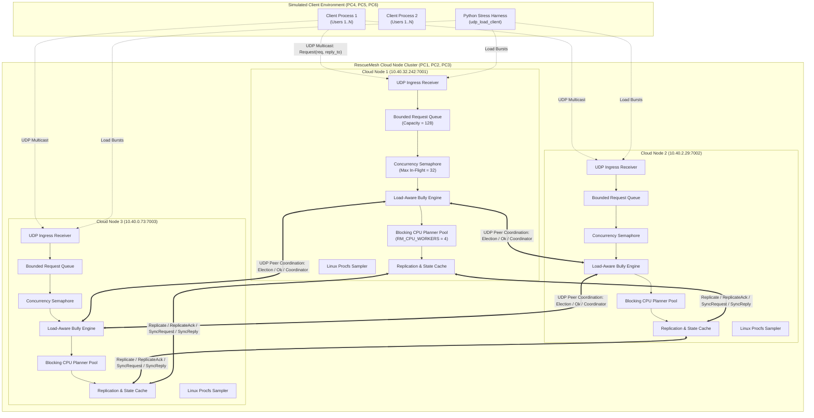
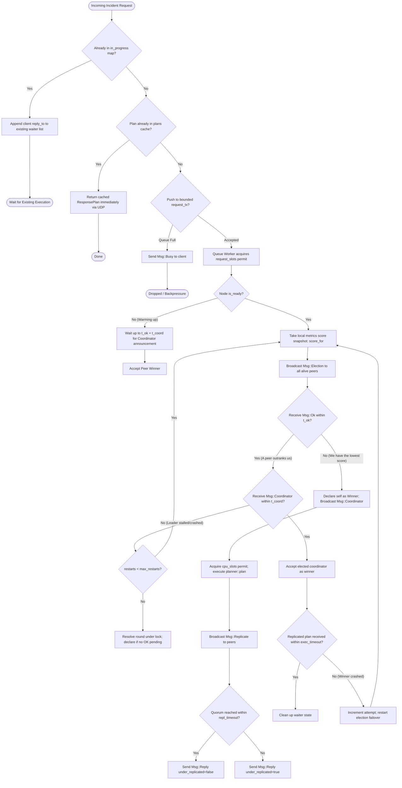
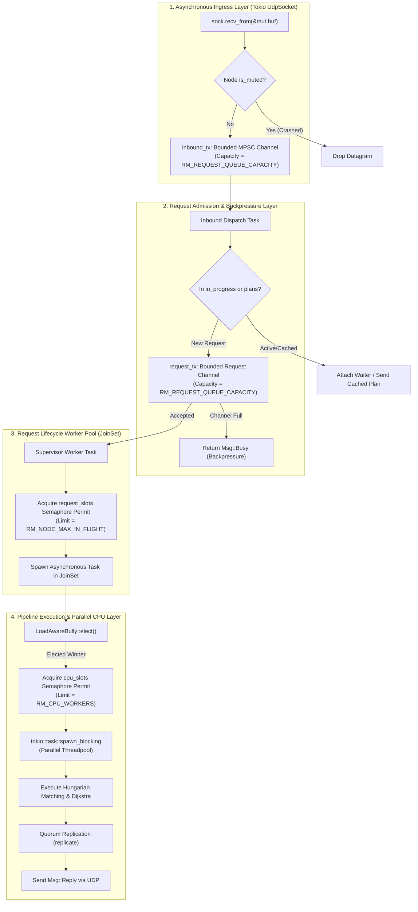

# RescueMesh: Technical Project Documentation
**A Cloud-P2P Environment for Smart-Campus Emergency Response and Resource Coordination**

* **Course**: CSCE 4411 – Distributed Systems
* **Term**: Fall 2026
* **Instructor**: Prof. Amr El-Kadi
* **Implementation Language**: Rust (2021 Edition, Tokio Asynchronous Runtime)
* **Target Environment**: Multi-PC Distributed Lab (6 Linux / Cross-Platform Nodes)

---

## Table of Contents
1. [Section 1 — Introduction and Project Overview](#section-1--introduction-and-project-overview)
2. [Section 2 — System Architecture](#section-2--system-architecture)
3. [Section 3 — Repository Structure](#section-3--repository-structure)
4. [Section 4 — Distributed Election Algorithm](#section-4--distributed-election-algorithm)
5. [Section 5 — Load Balancing](#section-5--load-balancing)
6. [Section 6 — Concurrent Request Processing and Parallelization](#section-6--concurrent-request-processing-and-parallelization)
7. [Section 7 — Incident Processing and Response Planning](#section-7--incident-processing-and-response-planning)
8. [Section 8 — Fault Tolerance and Failure Injection](#section-8--fault-tolerance-and-failure-injection)
9. [Section 9 — Replication, State Management, and Idempotency](#section-9--replication-state-management-and-idempotency)
10. [Section 10 — Network Communication and Message Protocols](#section-10--network-communication-and-message-protocols)
11. [Section 11 — Configuration and Deployment](#section-11--configuration-and-deployment)
12. [Section 12 — Testing and Validation](#section-12--testing-and-validation)
13. [Section 13 — Performance Evaluation and Experimental Analysis](#section-13--performance-evaluation-and-experimental-analysis)
14. [Section 14 — Design Decisions and Trade-offs](#section-14--design-decisions-and-trade-offs)
15. [Section 15 — Limitations and Future Improvements](#section-15--limitations-and-future-improvements)
16. [Section 16 — Requirements Compliance Matrix](#section-16--requirements-compliance-matrix)
17. [Section 17 — Team Contributions](#section-17--team-contributions)

---

## Section 1 — Introduction and Project Overview

### 1.1 Project Introduction
RescueMesh is an educational distributed systems platform developed in Rust for smart-campus emergency response and resource coordination. In an emergency scenario across a university campus (e.g., localized flooding, power outages, hazardous material spills, blocked roads, network outages, and medical emergencies), rapid coordination, fair resource matching, and reliable service availability are paramount. Because infrastructure components are subject to localized failures, network partitions, and heavy request surges, RescueMesh is designed from the ground up as a decentralized, fault-tolerant, and load-balanced distributed system.

### 1.2 Core Objectives
The primary objective of RescueMesh is to implement, validate, and benchmark core distributed systems primitives within a realistic simulation testbed:
1. **Dynamic Distributed Leader Election**: Selecting the optimal cloud processing peer on a per-request basis without relying on a fixed, centralized bottleneck.
2. **Multi-Metric Load Balancing**: Utilizing dynamic node metrics (CPU utilization, request queue backlog, execution latencies, memory consumption, I/O bandwidth, network RTT, and client reliability) to intelligently deflect workload away from strained nodes.
3. **Structured Concurrency and Parallel Execution**: Separating concurrent asynchronous network I/O, bounded queue buffering, worker task spawning, and parallel CPU-bound optimization algorithms.
4. **Resilient Quorum-Based Replication**: Guaranteeing state replication across peer nodes with explicit consistency guarantees and tracking of under-replicated requests during failures.
5. **Fault Injection and Graceful Recovery**: Simulating node crashes, testing failover under sustained client traffic, and executing state convergence protocols when failed nodes rejoin.
6. **Strict Operation Idempotency**: Ensuring that retried, duplicated, or concurrent multicast incident requests do not cause redundant state mutations or conflicting resource allocations.
7. **Campus Resource Optimization**: Executing an explainable response planning pipeline combining priority scoring, Dijkstra-based route calculation, Hungarian bipartite matching, and greedy resource reservation.

### 1.3 Distributed Systems Concepts Demonstrated
The implementation exercises key distributed systems paradigms:
* **Coordination & Agreement**: An adapted Load-Aware Bully Election algorithm with tie-breaking score buckets and hash-based transitivity.
* **Failure Detection**: Asynchronous peer heartbeat gossiping with configurable timeout thresholds (`fail_after`).
* **State Synchronization & Rejoin**: Chunked datagram snapshot pull protocols enabling reviving nodes to synchronize historical plan records prior to resuming election eligibility.
* **Quorum Acknowledgment**: Requiring a strict majority ($N/2 + 1$) of nodes to acknowledge response plans before marking work as fully replicated.
* **Conflict Resolution**: Total-order plan precedence rules ordering conflicting executions by `(attempt, origin_node_id)`.
* **Flow Control & Backpressure**: Bounded in-memory MPSC queues and Tokio semaphores guarding against out-of-memory crashes under severe burst traffic.

### 1.4 Educational Simulation Scope
RescueMesh is constructed strictly as an educational research prototype for CSCE 4411 (Fall 2026). It simulates physical campus geography through a deterministic synthetic graph generator and simulates edge clients via multi-task load generators. It is not approved or certified for real-world life-critical dispatch or production emergency infrastructure.

---

## Section 2 — System Architecture

The RescueMesh deployment consists of three peer cloud nodes running on dedicated hosts (or independent network ports) and a scalable number of concurrent client processes running across auxiliary physical or simulated nodes.

### 2.1 Component Overview
* **Cloud Nodes (Peers 1, 2, 3)**: Independent, equal peer processes. Each node maintains its own UDP transport, system metrics monitor, request queue, concurrency semaphores, local response cache, and state synchronization machinery. There is no static primary; leadership is dynamically determined per request.
* **Client Processes**: Independent client runtimes (e.g., `client` CLI or Python test drivers) simulating multiple campus reporters. Clients multicast emergency incident requests to all known cloud nodes simultaneously, wait for the elected winner's response plan, correlate responses by request ID, and acknowledge receipt.
* **Internal Coordination Channels**: All node-to-node coordination (heartbeats, election challenges, coordinator declarations, replication batches, state sync requests, and acknowledgments) travels over connectionless UDP datagrams serialized with `serde_json`.

### 2.2 System Architecture Diagrams

#### Diagram 1: Overall System Architecture


#### Diagram 2: Incident Request Lifecycle
```mermaid
sequenceDiagram
    autonumber
    participant Client as Client Worker Task
    participant N1 as Cloud Node 1 (Candidate)
    participant N2 as Cloud Node 2 (Elected Winner)
    participant N3 as Cloud Node 3 (Candidate)

    Client->>Client: Generate request_id: <client_id>-user-<U>-<seq>
    Client->>Client: Bind ephemeral UDP socket
    par Multicast Incident Request
        Client->>N1: Msg::Request { req, reply_to }
        Client->>N2: Msg::Request { req, reply_to }
        Client->>N3: Msg::Request { req, reply_to }
    end

    Note over N1,N3: Inbound UDP Dispatcher puts request into bounded request_tx queue
    par Queue Admission & Concurrency Permit
        N1->>N1: Acquire request_slots permit; Start attempt 0
        N2->>N2: Acquire request_slots permit; Start attempt 0
        N3->>N3: Acquire request_slots permit; Start attempt 0
    end

    Note over N1,N3: Nodes compute current load score and start LoadAwareBully::elect()
    par Bully Election Protocol
        N1->>N2: Msg::Election { req_id, attempt=0, score=N1_score }
        N1->>N3: Msg::Election { req_id, attempt=0, score=N1_score }
        N2->>N1: Msg::Ok { req_id, attempt=0 } (N2 outranks N1)
        N2->>N3: Msg::Election { req_id, attempt=0, score=N2_score }
        N3->>N1: Msg::Election { req_id, attempt=0, score=N3_score }
    end

    Note over N1: N1 received OK from N2 -> waits t_coord for Coordinator announcement
    Note over N3: N3 receives OK from N2 -> waits t_coord
    Note over N2: N2 receives NO OK -> N2 is the winner!
    N2->>N1: Msg::Coordinator { req_id, attempt=0, winner=2 }
    N2->>N3: Msg::Coordinator { req_id, attempt=0, winner=2 }

    Note over N1,N3: Losers enter exec_timeout wait loop waiting for replicated plan

    Note over N2: N2 acquires cpu_slots permit; spawn_blocking(planner::plan)
    N2->>N2: Compute priority, Dijkstra routes, Hungarian assignment
    N2->>N2: Release cpu_slots permit

    par Quorum Replication Phase
        N2->>N1: Msg::Replicate { plan, attempt=0, from=2 }
        N2->>N3: Msg::Replicate { plan, attempt=0, from=2 }
    end
    N1-->>N2: Msg::ReplicateAck { req_id, from=1 }
    Note over N2: Majority reached (1 peer ack + self = 2/3 quorum)

    N2->>Client: Msg::Reply { plan, under_replicated: false }
    Client->>N2: Msg::Ack { req_id }
    Note over N2: N2 records EWMA RTT & reliability for client
    Note over N1,N3: Replicated plan received; idempotency records and strategy rounds cleaned up
```

#### Diagram 3: Distributed Election and Workload Assignment


#### Diagram 4: Failure Detection, Failover, and Node Recovery
```mermaid
sequenceDiagram
    autonumber
    participant C as Client
    participant N1 as Node 1 (Live Peer)
    participant N2 as Node 2 (Target of Failure)
    participant N3 as Node 3 (Live Peer)

    Note over N1,N3: Heartbeats gossiped every 300 ms (Msg::Heartbeat)
    Note over N2: Failure Injected (Process killed or muted via mute_for / Ctrl+C)
    N2--xN1: Heartbeat stops
    N2--xN3: Heartbeat stops

    C->>N1: Request R1
    C->>N3: Request R1
    Note over N1,N3: Node 2 last_seen exceeds fail_after (1000 ms); Node 2 declared DEAD
    Note over N1,N3: N1 and N3 run Bully election excluding Node 2
    N1->>N3: Election challenge
    N1->>N1: N1 elected winner
    N1->>N3: Replicate R1
    N3-->>N1: ReplicateAck R1
    N1->>C: Reply R1 (Processed by Node 1, 100% success during mute)

    Note over N2: Node 2 Restarts / Unmutes (Rejoin Event)
    Note over N2: Node 2 sets ready=false; starts begin_warmup()
    N2->>N2: Wait up to warmup (600 ms) for peer heartbeats

    N1-->>N2: Msg::Heartbeat { from: 1 }
    Note over N2: Peer heard! Node 2 initiates state sync
    N2->>N1: Msg::SyncRequest { from: 2 }
    N1->>N2: Msg::SyncReply { part: 0, parts: 1, entries: [R1, ...] }
    Note over N2: Node 2 stores missing plans; resolves precedence; prints SYNC,2,1,plans_count
    Note over N2: Node 2 sets ready=true
    Note over N2: Node 2 now eligible to win elections again
```

---

## Section 3 — Repository Structure

The RescueMesh codebase is structured into clear separation of concerns across core modules, stress-testing harnesses, lab automation, and experimental datasets.

```
RescueMesh/
├── Cargo.toml                              # Workspace configuration & dependencies
├── Cargo.lock                              # Pinned dependency lockfile
├── README.md                               # Project banner
├── docs/
│   └── PHASE1_PARALLELIZATION.md           # Engineering specifications for Phase 1 parallelization
├── src/
│   ├── main.rs                             # CLI entrypoint (routes to node or client runtime)
│   ├── types.rs                            # Domain types: incidents, capabilities, plans, resources
│   ├── snapshot.rs                         # Synthetic campus zone graph, Dijkstra, SplitMix64 generator
│   ├── planner.rs                          # Service 1: Hungarian bipartite matching & priority scoring
│   ├── election.rs                         # LoadAwareBully algorithm, metrics sampler, score buckets
│   ├── node.rs                             # Cloud node UDP actor, queues, replication, failure detector
│   ├── client.rs                           # Client load simulator, ephemeral UDP sockets, metrics report
│   ├── fault_tolerance.rs                  # VersionVector, replicated log manager (standalone reference)
│   ├── rpc.rs                              # Reserved interface module (currently empty)
│   └── worker.rs                           # Reserved interface module (currently empty)
├── stress/
│   ├── README.md                           # Stress lab overview & guide index
│   ├── MULTI_PC_LAB_GUIDE.md               # 6-PC deployment, networking, and firewall configurations
│   ├── PHASE1_REPORT_GUIDE.md              # Official test protocols for experiments E1-E5
│   ├── DEMO_PHASE1.md                      # Live demonstration guidelines & checklist
│   ├── MISSING_PHASE1.md                   # Gap analysis and execution log
│   ├── lab/                                # Cluster orchestration & verification scripts
│   │   ├── nodes.env                       # Cluster IP mappings (PCs 1-6)
│   │   ├── check_connectivity.py           # Pre-flight TCP/UDP ping and reachability tester
│   │   ├── verify_ips.py                   # Local host IP verification script
│   │   ├── check_udp.sh                    # Low-level netcat UDP socket probe
│   │   ├── smoke_test.sh                   # Single-request sanity smoke test
│   │   ├── start_node.sh / Start-Node.ps1  # Node launcher scripts (Bash / PowerShell)
│   │   ├── start_client.sh / Start-Client.ps1 # Client launcher scripts (Bash / PowerShell)
│   │   └── run_client_ramp.sh / Run-ClientRamp.ps1 # Workload ramp runner
│   ├── report/                             # Metric analyzers and report generators
│   │   ├── check_requirements.py           # Automated Phase 1 criteria validation suite
│   │   ├── run_phase1_suite.py             # Orchestrator for test scenarios E1-E5
│   │   ├── udp_load_client.py              # High-precision standalone Python UDP benchmark client
│   │   ├── parse_election_logs.py          # Node stdout log parser extracting ELECTION records
│   │   ├── merge_election_overhead.py      # Multi-node election metrics merger
│   │   ├── analyze_request_csv.py          # Latency percentiles, throughput, and failover analyzer
│   │   └── build_report_tables.py          # Markdown report table formatter
│   └── results/                            # Raw CSV and summarized empirical experiment data
│       ├── e1_udp/                         # Experiment 1: Scale ramp (1 to 100 clients)
│       ├── e2_imbalance/                   # Experiment 2: Load imbalance (balanced vs. overloaded)
│       ├── e4_fail20/                      # Experiment 4: 20-second node crash & failover
│       ├── e5_rejoin/                      # Experiment 5: Node revive & state convergence
│       └── election_overhead/              # Merged multi-node election duration & overhead logs
```

### Detailed File Responsibilities

#### `src/main.rs`
* **Responsibility**: Application CLI dispatcher.
* **Key Structures & Functions**: `main()`.
* **Interaction**: Parses the first CLI argument (`node` or `client`). For `node`, parses `RM_NODES` and `RM_NODE_ID`, instantiates `Node`, calls `spawn_loops()`, and keeps the runtime alive via `std::future::pending()`. For `client`, loads `ClientConfig::from_env()`, executes `client::run_workload()`, and outputs structured `CLIENT_METRICS`.
* **Architectural Purpose**: Unified binary packaging allowing the same executable to serve as either cloud server or workload generator across lab machines.

#### `src/types.rs`
* **Responsibility**: System-wide data definitions and schema definitions.
* **Key Structures & Functions**: `IncidentCategory`, `IncidentStatus`, `IncidentRequest`, `ResponsePlan`, `Capability`, `ResourceKind`, `Responder`, `Resource`.
* **Interaction**: Shared across `client`, `planner`, `snapshot`, `node`, and `fault_tolerance`.
* **Architectural Purpose**: Defines immutable contracts for network serialization, request tracking, and resource allocation.

#### `src/snapshot.rs`
* **Responsibility**: World state representation and deterministic campus topology generation.
* **Key Structures & Functions**: `ZoneGraph`, `ShortestPaths`, `Snapshot`, `SnapshotSource`, `SyntheticSource`, `SnapshotParams`, `SplitMix64`, `generate()`.
* **Interaction**: Ingested by `planner::plan()` to evaluate available responders and calculate transit routes.
* **Architectural Purpose**: Simulates physical campus infrastructure without requiring an external database. Uses a deterministic PRNG (`SplitMix64`) with shared seeds across nodes to ensure identical snapshot evaluation on every peer.

#### `src/planner.rs`
* **Responsibility**: Computational optimization pipeline for emergency response planning (Service 1).
* **Key Structures & Functions**: `PlannerParams`, `PlanTrace`, `hungarian()`, `priority()`, `required_roles()`, `required_resource()`, `plan()`.
* **Interaction**: Invoked by `Node::execute()` inside a `tokio::task::spawn_blocking` pool to prevent CPU work from blocking network event loops.
* **Architectural Purpose**: Calculates incident urgency, solves minimum-cost responder matching using the Hungarian algorithm, greedily assigns emergency hardware, and computes Dijkstra routing.

#### `src/election.rs`
* **Responsibility**: Dynamic distributed coordinator selection and system load sampling.
* **Key Structures & Functions**: `ElectionStrategy`, `LoadAwareBully`, `Config`, `Metrics`, `Weights`, `Policy`, `Round`, `Outcome`, `outranks()`, `supersedes()`, `request_node_tie_key()`.
* **Interaction**: Called by `Node::process()` prior to executing each admitted request. Interacts with Linux `/proc` filesystem to harvest host telemetry.
* **Architectural Purpose**: Prevents static master bottlenecks and load concentration by electing the least-loaded node per request.

#### `src/node.rs`
* **Responsibility**: Core asynchronous network actor managing UDP transport, bounded queues, concurrency limits, replication, and failure handling.
* **Key Structures & Functions**: `Node`, `Msg`, `SyncEntry`, `SyncProgress`, `QueuedRequest`, `ActiveRequestGuard`, `spawn_loops()`, `handle()`, `process()`, `replicate()`, `sync_state()`.
* **Interaction**: Coordinates with remote `Node` instances via UDP, routes client requests, invokes `election` and `planner`, and synchronizes state upon recovery.
* **Architectural Purpose**: Serves as the primary operational engine of the RescueMesh cloud layer.

#### `src/client.rs`
* **Responsibility**: Multi-user client load generator and performance telemetry recorder.
* **Key Structures & Functions**: `ClientConfig`, `WorkloadReport`, `RequestMeasurement`, `run_workload()`, `submit_request()`.
* **Interaction**: Multicasts `Msg::Request` to all configured `RM_NODES`, waits for `Msg::Reply`, sends `Msg::Ack`, and aggregates statistical latencies.
* **Architectural Purpose**: Provides accurate client-side stress testing and benchmarking metrics without relying on third-party HTTP/RPC load tools.

#### `src/fault_tolerance.rs`
* **Responsibility**: Architectural reference implementation of version vectors, replicated commit logs, and state recovery.
* **Key Structures & Functions**: `FaultToleranceManager`, `VersionVector`, `LogEntry`, `IdempotencyRecord`, `PeerReplicationTransport`.
* **Interaction**: Designed as an abstract replicated log engine with complete standalone test coverage (`tests::test_three_node_failure_and_delta_recovery`).
* **Architectural Purpose**: Implements vector clocks and tombstone-based rollback logic. *Note: As verified in source code and compiler analysis, this module operates independently and is not wired into the active UDP `Node` request pipeline.*

---

## Section 4 — Distributed Election Algorithm

RescueMesh does not employ a static leader or a persistent consensus ring (such as Raft or Paxos). Instead, it implements a **Load-Aware Bully Election Algorithm** executed independently **per incident request**.

```mermaid
sequenceDiagram
    autonumber
    participant N1 as Node 1 (Candidate, Higher Load)
    participant N2 as Node 2 (Candidate, Lower Load)
    participant N3 as Node 3 (Candidate, Medium Load)

    Note over N1,N3: Request 'req-101' admitted on all nodes; attempt = 0
    Note over N1: Score = 4200 (Bucket 41)
    Note over N2: Score = 1500 (Bucket 14)
    Note over N3: Score = 2800 (Bucket 27)

    par Election Challenges Broadcasted
        N1->>N2: Msg::Election { req_id: "req-101", score: 4200 }
        N1->>N3: Msg::Election { req_id: "req-101", score: 4200 }
        N2->>N1: Msg::Election { req_id: "req-101", score: 1500 }
        N2->>N3: Msg::Election { req_id: "req-101", score: 1500 }
        N3->>N1: Msg::Election { req_id: "req-101", score: 2800 }
        N3->>N2: Msg::Election { req_id: "req-101", score: 2800 }
    end

    Note over N1: Evaluates challenges: N2 and N3 outrank N1
    Note over N3: Evaluates challenges: N2 outranks N3; sends OK to N1
    N3->>N1: Msg::Ok { req_id: "req-101" }

    Note over N2: Evaluates challenges: N2 outranks N1 and N3!
    N2->>N1: Msg::Ok { req_id: "req-101" }
    N2->>N3: Msg::Ok { req_id: "req-101" }

    Note over N1,N3: N1 and N3 received OK -> wait up to t_coord (500 ms) for coordinator announcement
    Note over N2: N2 received NO OK within t_ok (100 ms) -> N2 declares victory!

    par Coordinator Announcement Broadcasted
        N2->>N1: Msg::Coordinator { req_id: "req-101", winner: 2 }
        N2->>N3: Msg::Coordinator { req_id: "req-101", winner: 2 }
    end

    Note over N1,N3: Winner 2 recorded; losers wait for replicated plan
```

### 4.1 Theoretical Foundation vs. Practical Adaptation
In the classic Garcia-Molina Bully Algorithm, nodes possess fixed static identifiers ($1, 2, \dots, N$), and the node with the highest numerical ID always bullies lower-numbered nodes into submission. This classic formulation has two major deficiencies in high-throughput environments:
1. It creates an extreme bottleneck where Node $N$ must process 100% of the workload until it crashes.
2. It takes no account of resource exhaustion, CPU saturation, or network latency.

RescueMesh fundamentally adapts the algorithm:
* **Dynamic Metric Inversion**: Rather than comparing static IDs, nodes compare dynamic **load scores** computed at the inception of the election round. A *lower* score represents a healthier, less loaded node. A lower score bullies a higher score.
* **Score Bucketing (`SCORE_BUCKET_WIDTH = 101`)**: To avoid continuous re-elections and thrashing over negligible metric fluctuations (e.g., 0.1% CPU variance), scores are mapped into discrete buckets: $\lfloor \text{score} / 101 \rfloor$.
* **Deterministic Request Tie-Breaking**: When two nodes fall into the exact same score bucket, tie-breaking is determined by a request-specific 64-bit FNV-1a hash:
  ```rust
  fn request_node_tie_key(req_id: &str, node_id: NodeId) -> u64 {
      let mut hash = 0xcbf29ce484222325u64;
      for byte in req_id.bytes().chain(node_id.to_le_bytes()) {
          hash ^= u64::from(byte);
          hash = hash.wrapping_mul(0x100000001b3);
      }
      hash
  }
  ```
  This ensures that ties do not default to Node 1. Across different requests, ties hash to different nodes, preserving uniform load distribution.

### 4.2 Candidate Outranking Rule
The formal precedence predicate `outranks` is implemented in `src/election.rs`:
```rust
fn outranks(req_id: &str, score: u64, node_id: NodeId, other_score: u64, other_id: NodeId) -> bool {
    (
        score / SCORE_BUCKET_WIDTH,
        request_node_tie_key(req_id, node_id),
        node_id,
    ) < (
        other_score / SCORE_BUCKET_WIDTH,
        request_node_tie_key(req_id, other_id),
        other_id,
    )
}
```
This strict lexicographical ordering guarantees strict mathematical transitivity across all bucket boundaries, verified by unit test `test_score_order_is_transitive_across_bucket_boundaries`.

### 4.3 Election Protocol State Machine
1. **Initiation**: When an admitted request starts processing, the node checks `node.is_ready()`. If the node is warming up or synchronizing state, it abstains from candidacy, waiting passively for a peer's `Coordinator` announcement.
2. **Challenge Broadcast**: If ready, the node snapshots its score (`score_for(client)`) and broadcasts `Msg::Election { req_id, attempt, from, score, client }` to all alive peers. It schedules two automatic background retries at `(t_ok / 3).max(1ms)` to combat UDP packet drops.
3. **Challenge Evaluation**: Upon receiving an `Election` message, a peer checks if its own score outranks the challenger. If the peer outranks the challenger, it immediately transmits `Msg::Ok { req_id, attempt, from }`.
4. **Victory Declaration**: The initiating node awaits `Msg::Ok` for duration `t_ok` (default 100 ms).
   * **No `Ok` Received**: The node concludes that no superior candidate exists. It sets `round.coordinator = Some(self.id)` and broadcasts `Msg::Coordinator { req_id, attempt, winner: self.id }`.
   * **`Ok` Received**: A superior peer exists. The node enters a second wait loop of duration `t_coord` (default 500 ms) waiting for the `Coordinator` declaration.
5. **Failover & Re-election**: If `t_coord` elapses without a `Coordinator` message, the superior peer is presumed dead or stalled. The node restarts the election round (up to `max_restarts = 3`). If the elected winner later fails during execution, the remaining nodes increment `attempt` (up to `max_attempts = 4`) and re-elect a new winner.

### 4.4 Election Overhead and Message Complexity
For a cluster of $N$ nodes where all nodes receive a client request simultaneously:
* Each node broadcasts $N - 1$ `Election` messages: $N(N - 1)$ messages.
* Up to $N(N - 1) / 2$ `Ok` replies are transmitted.
* The winner transmits $N - 1$ `Coordinator` announcements.
* **Total Message Complexity**: $\mathcal{O}(N^2)$ per incident request.

In a 3-node cluster ($N=3$), a single election round generates approximately:
$$3 \times 2 = 6 \text{ Election} + 2 \text{ Ok} + 2 \text{ Coordinator} \approx 10 \text{ UDP datagrams}$$
Because elections execute per request, sustained client load increases control traffic proportionally. This represents an explicit design trade-off prioritizing immediate load responsiveness over consensus message minimization.

---

## Section 5 — Load Balancing

### 5.1 Telemetry Harvesting and Metrics Collection
The load balancing subsystem monitors physical machine health and application backlog in real time. In `src/election.rs`, a dedicated background task (`spawn_sampler`) periodically samples host telemetry every `sample_every` (default 500 ms).

#### Linux Procfs Telemetry
On Linux platforms, the sampler parses virtual filesystem interfaces:
* **CPU Utilization**: Read from `/proc/stat`. Computes aggregate non-idle ticks over elapsed duration and applies exponential smoothing:
  $$\text{cpu}_{\text{new}} = 0.3 \times \frac{\Delta \text{ticks}_{\text{active}}}{\Delta \text{ticks}_{\text{total}}} + 0.7 \times \text{cpu}_{\text{prev}}$$
* **Memory Consumption**: Read from `/proc/meminfo`:
  $$\text{mem} = 1.0 - \frac{\text{MemAvailable}}{\text{MemTotal}}$$
* **Disk I/O Bandwidth**: Read from `/proc/diskstats`. Aggregates sector reads and writes across physical block devices, converting to bytes/sec relative to `disk_cap_bps` (default 200 MB/s).
* **Network I/O Bandwidth**: Read from `/proc/net/dev`. Sums RX/TX bytes across non-loopback network interfaces relative to `net_cap_bps` (default 100 MB/s).
* **Cross-Platform Fallback**: On non-Linux operating systems (such as Windows development environments), procfs virtual paths do not exist. RescueMesh detects this at runtime, emits an explicit warning (`WARNING,METRICS,OS_UNSUPPORTED`), and defaults CPU, Memory, and I/O metrics to 0.0 while preserving queue-based and execution-time load balancing.

#### Application-Level Metrics
* **Queue Length**: Tracked atomically via `Metrics::queue`. Represents the number of requests actively executing or queued on the node.
* **Service Execution Latency**: Tracked via `Metrics::svc_ms` as an EWMA of completed `execute()` runtimes:
  $$\text{svc}_{\text{new}} = 0.2 \times \text{latency} + 0.8 \times \text{svc}_{\text{prev}}$$
* **Client Communication Quality**: Fed by client `Msg::Ack` packets. Tracks EWMA round-trip latency (`rtt_ms`) and historical reliability (`reliability`, decaying by 0.9 upon acknowledgment timeout).

### 5.2 Dynamic Score Formula
When an election begins, `Metrics::score` calculates the node's scalar score based on the configured `RM_POLICY`:

#### Policy: `Weighted` (Default)
$$\text{Score} = \left[ w_{\text{cpu}} \cdot \hat{C} + w_{\text{queue}} \cdot \hat{Q} + w_{\text{svc}} \cdot \hat{S} + w_{\text{io}} \cdot \hat{I} + w_{\text{mem}} \cdot \hat{M} + w_{\text{rel}} \cdot (1 - R) + w_{\text{delay}} \cdot \hat{D} + P \right] \times 10{,}000$$

Where normalized variables are clamped to $[0.0, 1.0]$:
* $\hat{C} = \text{clamp}(\text{cpu}, 0, 1)$
* $\hat{Q} = \min\left(\frac{\text{queue\_len}}{\text{queue\_cap}}, 1.0\right)$ (default `queue_cap` = 20.0)
* $\hat{S} = \min\left(\frac{\text{svc\_ms}}{\text{svc\_cap\_ms}}, 1.0\right)$ (default `svc_cap_ms` = 2000.0 ms; uninitialized defaults to $0.3 \times \text{svc\_cap\_ms}$)
* $\hat{I} = \text{clamp}(\text{io}, 0, 1)$
* $\hat{M} = \text{clamp}(\text{mem}, 0, 1)$
* $R = \text{client reliability} \in [0.0, 1.0]$
* $\hat{D} = \min\left(\frac{\text{client RTT}}{\text{rtt\_cap\_ms}}, 1.0\right)$ (default `rtt_cap_ms` = 100.0 ms)
* **Near-Disqualification Penalty ($P$)**: If $\text{cpu} > 0.95$, $\text{mem} > 0.90$, or $R < 0.5$, an emergency penalty of $P = 0.5$ (+5,000 score points) is added.

**Default Weights Configuration**:
* $w_{\text{cpu}} = 0.24$
* $w_{\text{queue}} = 0.24$
* $w_{\text{svc}} = 0.20$
* $w_{\text{io}} = 0.08$
* $w_{\text{mem}} = 0.04$
* $w_{\text{rel}} = 0.10$
* $w_{\text{delay}} = 0.10$
*(Machine capacity terms total 80%; network/communication terms total 20%).*

#### Alternative Evaluated Policies
* **`QueueOnly`**: $\text{Score} = \hat{Q} \times 10{,}000$
* **`CpuOnly`**: $\text{Score} = \hat{C} \times 10{,}000$
* **`Random`**: $\text{Score} = (\text{timestamp\_nanos} \pmod{10{,}000})$

### 5.3 Worked Numerical Example
The following realistic walkthrough illustrates how the scoring engine deflects requests away from an overloaded peer:

**Scenario Setup**:
* **Node 1 (Strained)**: CPU = 85% (0.85), Queue = 12 items, Service Time = 450 ms, I/O = 0.30, Mem = 0.60, RTT = 5 ms, Reliability = 1.0.
* **Node 2 (Healthy)**: CPU = 20% (0.20), Queue = 2 items, Service Time = 150 ms, I/O = 0.05, Mem = 0.35, RTT = 6 ms, Reliability = 1.0.
* **Node 3 (Healthy)**: CPU = 25% (0.25), Queue = 3 items, Service Time = 160 ms, I/O = 0.05, Mem = 0.40, RTT = 4 ms, Reliability = 1.0.

**Step 1: Normalization**:
* Node 1:
  * $\hat{C} = 0.85$
  * $\hat{Q} = 12 / 20 = 0.60$
  * $\hat{S} = 450 / 2000 = 0.225$
  * $\hat{I} = 0.30$, $\hat{M} = 0.60$, $1 - R = 0.0$, $\hat{D} = 5 / 100 = 0.05$.
* Node 2:
  * $\hat{C} = 0.20$
  * $\hat{Q} = 2 / 20 = 0.10$
  * $\hat{S} = 150 / 2000 = 0.075$
  * $\hat{I} = 0.05$, $\hat{M} = 0.35$, $1 - R = 0.0$, $\hat{D} = 6 / 100 = 0.06$.

**Step 2: Weighted Summation**:
* Node 1 raw sum:
  $$s_1 = (0.24 \times 0.85) + (0.24 \times 0.60) + (0.20 \times 0.225) + (0.08 \times 0.30) + (0.04 \times 0.60) + 0 + (0.10 \times 0.05)$$
  $$s_1 = 0.204 + 0.144 + 0.045 + 0.024 + 0.024 + 0.005 = 0.446$$
  $$\text{Score}_1 = 0.446 \times 10{,}000 = \mathbf{4460} \implies \text{Bucket} = \lfloor 4460 / 101 \rfloor = \mathbf{44}$$
* Node 2 raw sum:
  $$s_2 = (0.24 \times 0.20) + (0.24 \times 0.10) + (0.20 \times 0.075) + (0.08 \times 0.05) + (0.04 \times 0.35) + 0 + (0.10 \times 0.06)$$
  $$s_2 = 0.048 + 0.024 + 0.015 + 0.004 + 0.014 + 0.006 = 0.111$$
  $$\text{Score}_2 = 0.111 \times 10{,}000 = \mathbf{1110} \implies \text{Bucket} = \lfloor 1110 / 101 \rfloor = \mathbf{10}$$

**Step 3: Outcome**:
During election evaluation, Node 2's bucket (10) strictly outranks Node 1's bucket (44). Node 2 challenges Node 1 and sends `Msg::Ok`, suppressing Node 1. Node 2 is elected and assigned the incoming work.

---

## Section 6 — Concurrent Request Processing and Parallelization

A critical strength of RescueMesh is its rigorous separation between asynchronous network I/O, bounded queue buffering, multi-worker concurrency, and CPU-intensive parallel computation.



### 6.1 Client-Side Parallelization Model
The client architecture in `src/client.rs` manages high concurrency without overwhelming system file descriptors or OS thread schedulers:
* **Bounded User Workers**: Instead of spawning an unrestricted OS thread or Tokio task per simulated user, `run_workload()` bounds worker concurrency to:
  $$\text{workers} = \min(\text{RM\_CLIENT\_USERS}, \text{RM\_CLIENT\_MAX\_IN\_FLIGHT})$$
  User IDs ($0 \dots U-1$) are dispatched through a bounded Tokio MPSC channel to this worker pool.
* **In-Flight Semaphore Capping**: Client concurrency is guarded by a shared `Arc<Semaphore>` initialized to `RM_CLIENT_MAX_IN_FLIGHT` (default 32). A user task must acquire a permit before generating and submitting an incident. The time spent awaiting this permit is measured and reported as `mean_client_queue_wait_ms`.
* **Isolated Ephemeral Sockets**: Every concurrent client request binds its own ephemeral UDP socket (`UdpSocket::bind("0.0.0.0:0")`). This eliminates shared response dispatch locks and guarantees that a delayed or dropped datagram for user $A$ cannot stall or block socket buffers for user $B$.
* **Request Correlation**: Each request receives a globally unique identifier:
  $$\text{request\_id} = \text{format!}\{\text{"}\{\}\text{-user-}\{\}\text{-}\{\}\text{", client\_id, user\_id, sequence}\}$$
  The client socket waits exclusively for a `Msg::Reply` containing that matching `request_id`.

### 6.2 Cloud-Node Parallelization Model
The cloud node in `src/node.rs` coordinates concurrent requests through four distinct stages:
1. **Asynchronous Network Ingress**: A dedicated Tokio task loops continuously on `sock.recv_from(&mut buf)`. Decoded messages are forwarded across a bounded in-memory channel (`incoming_tx`, capacity = `RM_REQUEST_QUEUE_CAPACITY`, default 128). If the ingress channel fills, the receive loop naturally pauses, pushing backpressure into the operating system's kernel UDP socket buffers.
2. **Admission and Duplicate Filtering**: The inbound dispatcher receives incoming datagrams and examines `in_progress` and `plans` under a short-lived mutex. If a request ID is already processing, the sender's address is simply registered in the waiter list. If the request is new, it is pushed to `request_tx`. If `request_tx` is at capacity, the node immediately replies with `Msg::Busy`, shedding excess load rather than crashing.
3. **Bounded Request Worker Pool**: A supervisor loop dequeues items from `request_rx`. Before spawning a request handler, it must acquire an owned permit from `request_slots` (`Arc<Semaphore>`, capacity = `RM_NODE_MAX_IN_FLIGHT`, default 32). Handler tasks are registered inside a `tokio::task::JoinSet`. If a spawned task aborts or panics, the JoinSet supervisor detects the failure, purges state, and notifies waiters with `Msg::Busy`.
4. **Parallel CPU-Bound Planning**: Incident optimization is computationally heavy. To prevent long-running mathematical algorithms from starving Tokio's asynchronous I/O worker threads, `Node::execute()` offloads planning to Tokio's blocking threadpool via `tokio::task::spawn_blocking`. Concurrency in the blocking pool is independently bounded by a dedicated semaphore: `RM_CPU_WORKERS` (default 4). The simulated network service delay (`RM_SIM_DELAY_MS`, default 300 ms) remains asynchronous (`tokio::time::sleep`) and consumes zero CPU thread time.

### 6.3 Technical Terminology Disambiguation
To maintain scientific precision, RescueMesh strictly differentiates between concurrency concepts:
* **Concurrent Request Handling**: Interleaving multiple active request lifecycles (elections, replication waits, timeouts) across cooperative asynchronous Tokio tasks on non-blocking event loops.
* **Parallel CPU Execution**: Executing multiple Hungarian bipartite matchings simultaneously across separate physical CPU hardware threads via `spawn_blocking`.
* **Asynchronous Network I/O**: Performing socket polling, datagram receipt, and network transmissions using non-blocking OS primitives (epoll on Linux / IOCP on Windows) without blocking executing threads.
* **Multi-Process Simulation**: Running independent OS processes across multiple physical workstations (PCs 1–6) communicating strictly through physical network interfaces.

---

## Section 7 — Incident Processing and Response Planning

Incident processing constitutes Service 1 of the RescueMesh specification, implemented in `src/planner.rs` and `src/snapshot.rs`.

### 7.1 Incident Schema and Supported Categories
An incident request contains unambiguous metadata:
```rust
pub struct IncidentRequest {
    pub request_id: String,
    pub incident_id: String,
    pub reporter_id: String,
    pub category: IncidentCategory,
    pub location_zone: u32,
    pub severity: u8,
    pub timestamp_ms: u64,
    pub status: IncidentStatus,
    pub ttl_secs: u64,
}
```

Six incident categories are supported, each carrying a domain urgency weight:
1. `MedicalTechnicalAssistance` (Urgency = 1.0)
2. `LabIncident` (Urgency = 0.9)
3. `LocalizedFlooding` (Urgency = 0.7)
4. `PowerOutage` (Urgency = 0.6)
5. `BlockedRoad` (Urgency = 0.5)
6. `NetworkOutage` (Urgency = 0.4)

### 7.2 Priority Calculation
Priority is scored on a continuous scale from $0.0$ to $100.0$:
$$\text{Priority} = \left[ w_{\text{sev}} \cdot \left(\frac{\text{clamp}(\text{severity}, 1, 5)}{5.0}\right) + w_{\text{age}} \cdot \text{clamp}\left(\frac{\text{age\_s}}{\text{age\_cap\_s}}, 0.0, 1.0\right) + w_{\text{cat}} \cdot \text{urgency} \right] \times 100.0$$

*Default Parameter Values*:
* $w_{\text{sev}} = 0.5$ (Configurable via `RM_PW_SEV`)
* $w_{\text{age}} = 0.25$ (`RM_PW_AGE`)
* $w_{\text{cat}} = 0.25$ (`RM_PW_CAT`)
* $\text{age\_cap\_s} = 600.0\text{ seconds}$ (`RM_AGE_CAP_S`)

### 7.3 Multi-Incident Backlog Competition
When a new incident arrives, it cannot be planned in isolation because campus emergency responders are finite. In `plan()`, the new incident is combined with the snapshot's existing backlog of open incidents (`snap.backlog`). All incidents are sorted in descending order of priority, with ties broken deterministically by incident ID.

### 7.4 Required Roles and Resource Demands
Each incident category requires specific personnel capabilities (`Capability`):
* `BlockedRoad`: Security, Logistics
* `PowerOutage`: Electrical, Security
* `LabIncident`: Hazmat, Medical
* `LocalizedFlooding`: Plumbing, Logistics
* `NetworkOutage`: Network
* `MedicalTechnicalAssistance`: Medical, Logistics

*Severity Scaling*:
* If $\text{severity} \ge 4$, an additional slot of the primary role is added.
* If $\text{severity} \ge 5$, an additional `Security` role is appended.

*Emergency Hardware Resources*:
* `BlockedRoad` $\implies$ `Barrier`
* `PowerOutage` $\implies$ `Generator`
* `LabIncident` $\implies$ `HazmatKit`
* `LocalizedFlooding` $\implies$ `WaterPump`
* `NetworkOutage` $\implies$ `RouterKit`
* `MedicalTechnicalAssistance` $\implies$ `MedKit`
* *Quantity*: 2 units if severity $\ge 4$, else 1 unit.

### 7.5 Hungarian Bipartite Matching
Every required role across all competing incidents represents a distinct slot. Available responders ($r$) satisfying $r.\text{availability} \ge \text{min\_availability}$ (default 0.3) represent assignment candidates.

The matching cost between slot $s$ (at incident zone $z$) and responder $r$ is:
$$\text{Cost}(s, r) = w_{\text{dist}} \cdot \left(\frac{d(z, r.\text{zone})}{d_{\max}}\right) + w_{\text{cap}} \cdot [\text{skill\_missing}] + w_{\text{avail}} \cdot (1.0 - r.\text{availability})$$

*Default Cost Weights*:
* $w_{\text{dist}} = 0.4$ (`RM_AW_DIST`)
* $w_{\text{cap}} = 0.5$ (`RM_AW_CAP` — penalty is 0.0 if responder possesses capability, 1.0 if missing)
* $w_{\text{avail}} = 0.1$ (`RM_AW_AVAIL`)

To guarantee feasibility when slots exceed responders, dummy "unassigned" columns are added, priced at:
$$\text{Cost}_{\text{unassigned}} = \text{unassigned\_cost} \times \left(1.0 + \frac{\text{priority}}{100.0}\right)$$
(Default `unassigned_cost` = 2.0). Higher-priority incidents penalize unassigned slots more severely, ensuring the Hungarian algorithm allocates scarce skilled personnel to the most critical emergencies. The algorithm executes in $\mathcal{O}(\text{slots}^2 \cdot \text{candidates})$ time.

### 7.6 Route Calculation and Resource Allocation
* **Route Calculation**: Shortest path trees from the incident zone are computed using Dijkstra's algorithm with integer edge travel times. The recommended route in the plan traces the path from the primary assigned responder's zone to the incident location.
* **Greedy Resource Consumption**: Hardware resources are consumed greedily in priority order. For each incident, eligible resources are sorted by shortest Dijkstra distance, then availability, and depleted until demand is satisfied.

---

## Section 8 — Fault Tolerance and Failure Injection

RescueMesh implements explicit fault-injection hooks and failure-recovery protocols to validate campus resilience.

```mermaid
sequenceDiagram
    autonumber
    participant C as Clients
    participant N1 as Node 1 (Follower)
    participant N2 as Node 2 (Active Leader)
    participant N3 as Node 3 (Follower)

    Note over N2: Fault Injected: Node 2 Killed / Muted (t = 0s)
    C->>N1: Request(req-200)
    C->>N2: Request(req-200) (Lost/Ignored)
    C->>N3: Request(req-200)

    Note over N1,N3: Node 2 fails to send heartbeats
    Note over N1,N3: At t = 1.0s (fail_after), Node 2 marked DEAD in alive_peers()
    
    par Failover Election
        N1->>N3: Msg::Election { req_id: "req-200", attempt: 0 }
        N3->>N1: Msg::Ok { req_id: "req-200" } (N3 outranks N1)
        N3->>N1: Msg::Coordinator { req_id: "req-200", winner: 3 }
    end

    Note over N3: Node 3 executes plan; replicates to Node 1
    N3->>N1: Msg::Replicate { plan, attempt: 0, from: 3 }
    N1-->>N3: Msg::ReplicateAck { req_id: "req-200", from: 1 }
    N3->>C: Msg::Reply { plan, under_replicated: false }
    Note over C: Client experiences seamless failover (~286 ms)

    Note over N2: Node 2 Revives / Restarts (t = 20s)
    Note over N2: Node 2 sets ready=false; starts begin_warmup()
    Note over N2: Ignores election requests while warming up

    N1-->>N2: Msg::Heartbeat { from: 1 }
    Note over N2: Peer detected; Node 2 triggers sync_state()
    N2->>N1: Msg::SyncRequest { from: 2 }
    N1->>N2: Msg::SyncReply { part: 0, parts: 1, entries: [req-200, ...] }
    Note over N2: Missing plans merged; Node 2 sets ready=true
    Note over N2: Node 2 resumes full election eligibility
```

### 8.1 Server Failure Simulation
Node failures can be injected through two verified mechanisms:
1. **In-Process Muting**: Calling `Node::mute_for(secs)` or setting `muted = true`. While muted, `sock.recv_from` discards all incoming packets, outbound sends are silenced, and background tasks are bypassed.
2. **Process Termination**: In physical lab stress tests (Scenario E4), failure is injected by sending `SIGINT` (Ctrl+C) or `SIGKILL` directly to the cloud node process.

### 8.2 Failure Detection
Cloud nodes broadcast membership heartbeats (`Msg::Heartbeat { from: self.id }`) every `heartbeat` interval (default 300 ms). Each node maintains a `last_seen: Mutex<HashMap<NodeId, Instant>>` map.
* A peer is considered alive if:
  $$\text{now} - \text{last\_seen}(P) < \text{cfg.fail\_after}\quad (\text{default } 1000\text{ ms})$$
* Dead nodes are automatically filtered out of `alive_peers()`.

### 8.3 In-Flight Failover and Re-election
If a node elected as coordinator crashes before completing plan computation or replication:
1. Loser nodes wait in an execution loop up to `exec_timeout` (default 3000 ms).
2. During each iteration, losers check if `out.winner` is still present in `alive_nodes()`.
3. If the winner vanishes from `alive_nodes()` or `exec_timeout` expires without receiving the replicated plan, the surviving nodes log a failover event:
   ```text
   [node X] winner Y of req-Z looks dead -> re-election
   ```
4. Surviving nodes increment `attempt` and trigger a new election round. The client is shielded from the internal crash, receiving the result from the failover winner.

### 8.4 Node Recovery and Rejoin Protocol
When a crashed node restarts or unmutes, it must not immediately participate in elections because its local state is stale. RescueMesh implements a three-step **Rejoin Guard**:
1. **Warmup Phase (`begin_warmup`)**: The node sets `ready = false`. If `cfg.rejoin_guard` is active, it waits up to `warmup` (default 600 ms) listening for peer heartbeats. While `ready == false`, the node abstains from winning elections.
2. **State Pull Synchronization (`sync_state`)**: Upon hearing an active peer, the revived node sends `Msg::SyncRequest { from: self.id }`.
   * The responding peer packages all stored plans into chunked datagrams (`SYNC_CHUNK = 8` entries per packet to stay well within UDP MTU limits) and replies with `Msg::SyncReply { part, parts, entries }`.
   * The reviving node receives the chunks, updates its local cache using the `supersedes()` precedence rule, and emits:
     ```text
     SYNC,<node_id>,<peer_id>,<plans_synced>
     ```
3. **Resumption of Active Service**: Once all synchronization parts are received (or after `SYNC_ATTEMPTS = 3` timeouts), the node marks `ready = true` and resumes full candidacy.

---

## Section 9 — Replication, State Management, and Idempotency

### 9.1 Replicated State
Each cloud node maintains state in protected in-memory structures:
* `plans: Mutex<HashMap<String, (ResponsePlan, bool)>>`: Maps `request_id` to the completed `ResponsePlan` and a boolean flag indicating if it is `under_replicated`.
* `plan_prec: Mutex<HashMap<String, (u32, NodeId)>>`: Maps `request_id` to the `(attempt, origin_node)` precedence tuple of the stored plan.
* `started: Mutex<HashSet<String>>`: Tracks request IDs that have begun local CPU execution to prevent duplicate local execution.
* `in_progress: Mutex<HashMap<String, Vec<(SocketAddr, String)>>>`: Tracks in-flight request IDs and all registered client waiter addresses.

### 9.2 Quorum-Based Replication Flow
When a node wins an election and completes plan computation:
1. It enters `Node::replicate()`.
2. It calculates the required peer acknowledgments:
   $$\text{need} = \left(\left\lfloor \frac{N}{2} \right\rfloor + 1\right) - 1$$
   *(In a 3-node cluster, $\lfloor 3/2 \rfloor + 1 = 2$ total nodes required for quorum; subtracting the local node yields $\text{need} = 1$ peer ACK).*
3. The winner sends `Msg::Replicate { plan, attempt, from: self.id }` to all alive peers.
4. Peers store the plan and reply with `Msg::ReplicateAck { request_id, from: peer_id }`.
5. If $\ge 1$ peer ACK arrives before `repl_timeout` (default 1500 ms), replication succeeds.
6. If quorum is not achieved, the winner still caches the plan locally but marks `under_replicated = true`. The client receives `Msg::Reply { plan, under_replicated: true }`.

### 9.3 Idempotency and Duplicate Suppression
Emergency dispatch systems must handle duplicate requests gracefully (e.g., when a user aggressively clicks "Submit" or network retries occur). RescueMesh enforces multi-layered idempotency:
* **Multicast Waiter Joining**: When duplicate requests with the same `request_id` arrive while the request is queued or executing, `Node::handle()` detects the ID in `in_progress`. It appends the duplicate sender's socket to the existing waiter list without launching redundant execution. When the single execution completes, replies are transmitted to all waiters.
* **Completed Cache Retries**: If a duplicate request arrives after completion, `Node::handle()` detects the ID in `plans` and immediately returns the cached plan without re-running elections or planning.
* **Execution Guard**: Before launching CPU planning, `self.started.lock().unwrap().insert(id.clone())` atomically verifies that the request has not started locally.

### 9.4 Plan Conflict Precedence Rule
If a network partition or false failure detection causes two nodes to simultaneously execute the same request ID, state convergence is guaranteed by a deterministic conflict resolution rule:
```rust
pub fn supersedes(new: (u32, NodeId), old: (u32, NodeId)) -> bool {
    new.0 > old.0 || (new.0 == old.0 && new.1 < old.1)
}
```
A plan with a higher election `attempt` always overwrites a plan from an earlier attempt. If attempts are identical, the plan generated by the node with the numerically lower `NodeId` wins. This ensures all nodes converge on the exact same plan during state synchronization.

---

## Section 10 — Network Communication and Message Protocols

### 10.1 Communication Technology
All inter-node and client-to-node communication uses **UDP (User Datagram Protocol)**. UDP was chosen to eliminate connection-establishment handshakes, avoid TCP head-of-line blocking during packet drops, and enable lightweight multicast request delivery.

### 10.2 Serialization and Framing
Messages are serialized into JSON using `serde` and `serde_json`. While binary formats (such as Protocol Buffers or Bincode) offer higher byte compactness, JSON was chosen for transparent debugging, human-readable network inspection, and direct interoperability with Python testing harnesses.
* **Receive Buffer Size**: Sockets allocate a 16 KiB buffer (`vec![0u8; 16384]`), which safely accommodates the maximum serialized `ResponsePlan` and chunked `SyncReply` payloads.

### 10.3 Protocol Message Variants
Defined in `src/node.rs`:
```rust
#[derive(Serialize, Deserialize, Clone, Debug)]
pub enum Msg {
    // Membership
    Heartbeat { from: NodeId },

    // Client <-> Cloud
    Request { req: IncidentRequest, reply_to: SocketAddr },
    Reply { plan: ResponsePlan, under_replicated: bool },
    Busy { request_id: String, node_id: NodeId },
    Ack { request_id: String },

    // Replication
    Replicate { plan: ResponsePlan, attempt: u32, from: NodeId },
    ReplicateAck { request_id: String, from: NodeId },

    // State Sync (Rejoin)
    SyncRequest { from: NodeId },
    SyncReply { from: NodeId, part: u32, parts: u32, entries: Vec<SyncEntry> },

    // Election (Bully)
    Election { req_id: String, attempt: u32, from: NodeId, score: u64, client: String },
    Ok { req_id: String, attempt: u32, from: NodeId },
    Coordinator { req_id: String, attempt: u32, winner: NodeId },

    // Baseline Comparison
    Bid { req_id: String, attempt: u32, from: NodeId, score: u64 },
}
```

### 10.4 Concrete Message Payloads

#### `Msg::Request` (Client to Nodes)
```json
{
  "Request": {
    "req": {
      "request_id": "client-4411-user-1-0",
      "incident_id": "incident-client-4411-user-1-0",
      "reporter_id": "client-4411-user-1",
      "category": "BlockedRoad",
      "location_zone": 7,
      "severity": 3,
      "timestamp_ms": 1793722095000,
      "status": "Open",
      "ttl_secs": 300
    },
    "reply_to": "10.40.1.240:54321"
  }
}
```

#### `Msg::Election` (Node to Peers)
```json
{
  "Election": {
    "req_id": "client-4411-user-1-0",
    "attempt": 0,
    "from": 1,
    "score": 1110,
    "client": "client-4411-user-1"
  }
}
```

#### `Msg::Reply` (Winner to Client)
```json
{
  "Reply": {
    "plan": {
      "request_id": "client-4411-user-1-0",
      "incident_id": "incident-client-4411-user-1-0",
      "priority_score": 42.5,
      "assigned_responders": ["R12", "R4"],
      "assigned_resources": ["S2"],
      "recommended_route": [3, 4, 7],
      "processed_by_node": 2
    },
    "under_replicated": false
  }
}
```

---

## Section 11 — Configuration and Deployment

RescueMesh is configurable via environment variables, with robust default fallbacks.

### 11.1 Configuration Parameters Reference

| Variable | Target | Default | Description |
|---|---|---:|---|
| `RM_NODES` | Node / Client | `1@127.0.0.1:7001,2@127.0.0.1:7002,3@127.0.0.1:7003` | Comma-separated cluster peer mapping (`ID@IP:PORT`) |
| `RM_NODE_ID` | Node | `1` | Integer ID of this cloud node process |
| `RM_POLICY` | Node | `weighted` | Election scoring policy (`weighted`, `queue`, `cpu`, `random`) |
| `RM_NODE_MAX_IN_FLIGHT` | Node | `32` | Max concurrent active request lifecycles (semaphore permit) |
| `RM_CPU_WORKERS` | Node | `4` | Max concurrent blocking planner optimization threads |
| `RM_REQUEST_QUEUE_CAPACITY`| Node | `128` | Capacity limit for ingress channel and request queue |
| `RM_SIM_DELAY_MS` | Node | `300` | Artificial async service delay simulating computational effort |
| `RM_T_OK_MS` | Node | `100` | Duration to wait for peer `Ok` response during election |
| `RM_T_COORD_MS` | Node | `500` | Duration to wait for peer `Coordinator` announcement |
| `RM_EXEC_TIMEOUT_MS` | Node | `3000` | Duration election losers wait for replicated plan before re-electing |
| `RM_REPL_TIMEOUT_MS` | Node | `1500` | Timeout deadline to achieve quorum replication acknowledgment |
| `RM_REPL_RETRY_MS` | Node | `150` | Resend interval for replication datagrams to un-acknowledged peers |
| `RM_HEARTBEAT_MS` | Node | `300` | Interval between node membership heartbeat broadcasts |
| `RM_FAIL_AFTER_MS` | Node | `1000` | Silence duration after which an unresponsive peer is declared dead |
| `RM_WARMUP_MS` | Node | `600` | Maximum wait time during node restart before serving independently |
| `RM_REJOIN_GUARD` | Node | `1` | Enable (1) or disable (0) state synchronization upon rejoining |
| `RM_CLIENT_ID` | Client | Auto (PID + timestamp) | Namespace prefix for simulated client requests |
| `RM_CLIENT_USERS` | Client | `10` | Number of concurrent simulated user tasks |
| `RM_CLIENT_REQUESTS_PER_USER` | Client | `10` | Sequential requests submitted per simulated user |
| `RM_CLIENT_MAX_IN_FLIGHT` | Client | `32` | Maximum concurrent requests permitted by client semaphore |
| `RM_CLIENT_TIMEOUT_MS` | Client | `5000` | Per-request timeout deadline before recording a client timeout |
| `RM_CLIENT_RATE_MS` | Client | `0` | Delay between consecutive requests submitted by a user |

### 11.2 Building the Project
From the repository root:
```bash
# Debug build (for rapid compilation and local unit testing)
cargo build

# Release build (mandatory for stress testing and latency benchmarking)
cargo build --release
```

### 11.3 Local Cluster Deployment (Single Workstation)
To simulate the three-node cluster locally, open three separate terminal windows:

**Terminal 1 (Node 1)**:
```powershell
$env:RM_NODES = "1@127.0.0.1:7001,2@127.0.0.1:7002,3@127.0.0.1:7003"
$env:RM_NODE_ID = "1"
.\target\release\rescue_mesh.exe node
```

**Terminal 2 (Node 2)**:
```powershell
$env:RM_NODES = "1@127.0.0.1:7001,2@127.0.0.1:7002,3@127.0.0.1:7003"
$env:RM_NODE_ID = "2"
.\target\release\rescue_mesh.exe node
```

**Terminal 3 (Node 3)**:
```powershell
$env:RM_NODES = "1@127.0.0.1:7001,2@127.0.0.1:7002,3@127.0.0.1:7003"
$env:RM_NODE_ID = "3"
.\target\release\rescue_mesh.exe node
```

**Terminal 4 (Simulated Workload Client)**:
```powershell
$env:RM_NODES = "1@127.0.0.1:7001,2@127.0.0.1:7002,3@127.0.0.1:7003"
$env:RM_CLIENT_USERS = "20"
$env:RM_CLIENT_REQUESTS_PER_USER = "10"
$env:RM_CLIENT_MAX_IN_FLIGHT = "16"
.\target\release\rescue_mesh.exe client
```

### 11.4 Multi-PC Physical Lab Deployment (6 Physical Workstations)
In the CSCE 4411 distributed systems laboratory, RescueMesh is deployed across six physical Linux workstations configured as follows:

| Role | Workstation | IP Address | Port / Protocol |
|---|---|---|---|
| Cloud Node 1 | PC1 | `10.40.32.242` | UDP 7001 |
| Cloud Node 2 | PC2 | `10.40.2.29` | UDP 7002 |
| Cloud Node 3 | PC3 | `10.40.0.73` | UDP 7003 |
| Load Client 1 | PC4 | `10.40.1.240` | Ephemeral UDP |
| Load Client 2 | PC5 | `10.40.39.134` | Ephemeral UDP |
| Load Client 3 | PC6 | `10.40.5.45` | Ephemeral UDP |

#### Step 1: Pre-Flight Network Setup (Every PC)
Allow inbound UDP traffic on the configured ports:
```bash
# On PC1:
sudo ufw allow 7001/udp
# On PC2:
sudo ufw allow 7002/udp
# On PC3:
sudo ufw allow 7003/udp
```

#### Step 2: Start Cloud Nodes
Export the shared peer mapping:
```bash
export RM_NODES="1@10.40.32.242:7001,2@10.40.2.29:7002,3@10.40.0.73:7003"
```
* **On PC1**: `export RM_NODE_ID=1 && cargo run --release -- node 2>&1 | tee /tmp/node1.log`
* **On PC2**: `export RM_NODE_ID=2 && cargo run --release -- node 2>&1 | tee /tmp/node2.log`
* **On PC3**: `export RM_NODE_ID=3 && cargo run --release -- node 2>&1 | tee /tmp/node3.log`

#### Step 3: Run Automated Test Campaigns from Coordinator PC (PC4)
```bash
cd RescueMesh
source stress/lab/nodes.env

# Run scale ramp experiment E1
python3 stress/report/run_phase1_suite.py --scenario e1

# Run 20s server failure experiment E4
python3 stress/report/run_phase1_suite.py --scenario e4 --clients 30 --duration-s 60 --mute-s 20 --fail-after-s 15

# Verify complete compliance checklist
python3 stress/report/check_requirements.py
```

---

## Section 12 — Testing and Validation

The repository contains 30 automated Rust tests covering algorithmic correctness, mathematical transitivity, graph connectivity, vector clocks, and concurrent network behavior.

### 12.1 Test Suite Breakdown

| Module | Test Name | Category | Verification Scenario & Invariants Asserted |
|---|---|---|---|
| `snapshot` | `generation_is_deterministic_per_seed` | Unit | Asserts that identical seeds produce bit-for-bit identical snapshots, while differing seeds produce different topologies. |
| `snapshot` | `graph_is_connected_and_routes_end_at_source` | Unit | Asserts that generated campus graphs contain no disconnected zones and Dijkstra paths terminate at the target source. |
| `snapshot` | `dijkstra_prefers_cheaper_two_hop_path` | Unit | Asserts that Dijkstra selects a multi-hop path with lower total cost over an expensive direct link. |
| `planner` | `priority_rises_with_severity_and_age_and_category` | Unit | Validates that urgency scores scale monotonically with higher severity, greater age, and higher category urgency. |
| `planner` | `no_responders_gives_empty_assignment_and_trivial_route`| Unit | Validates that when responder candidates are empty, Hungarian assignment degrades gracefully without panicking. |
| `planner` | `hungarian_matches_brute_force_on_random_matrices` | Unit | Compares Hungarian solver outputs against brute-force permutation search over random cost matrices. |
| `planner` | `prefers_closer_responder_when_skills_equal` | Unit | Asserts that when capabilities match, the responder with minimal Dijkstra transit cost is assigned. |
| `planner` | `picks_skilled_responder_over_closer_unskilled_one` | Unit | Asserts that capability weight ($w_{\text{cap}}=0.5$) overrides proximity when assigning specialized emergencies. |
| `planner` | `skips_unavailable_responders` | Unit | Validates that responders with availability below `min_availability` (0.3) are excluded from matching. |
| `planner` | `route_runs_from_responder_zone_to_incident_zone` | Unit | Validates that computed transit routes trace contiguous hops from the responder's initial zone to the incident zone. |
| `planner` | `resources_are_matched_by_kind_nearest_first_and_quantity_is_consumed` | Unit | Asserts that resource allocation consumes nearest available inventory and properly depletes remaining stock. |
| `planner` | `high_priority_incident_wins_the_only_skilled_responder` | Unit | Validates multi-incident competition: higher-priority backlog items win contested single responders. |
| `planner` | `same_input_gives_identical_plan_on_any_node` | Unit | Proves planning determinism: identical inputs on separate nodes yield identical response plans. |
| `planner` | `plan_cost_grows_with_backlog_and_pool_size` | Unit | Asserts that computational planning cost scales with larger responder candidate pools and backlogs. |
| `election` | `lower_score_buckets_always_outrank_higher_buckets` | Unit | Validates that score bucket $\lfloor s_1 / 101 \rfloor < \lfloor s_2 / 101 \rfloor$ guarantees outranking regardless of node IDs. |
| `election` | `tied_score_buckets_use_request_specific_node_order` | Unit | Validates that score ties utilize request-specific FNV-1a hashing, distributing tie-break winners evenly. |
| `election` | `score_order_is_transitive_across_bucket_boundaries`| Unit | Formally asserts mathematical transitivity: if $A \prec B$ and $B \prec C$, then $A \prec C$ for all combinations. |
| `fault_tolerance` | `test_rollback_when_zero_peer_acks` | Unit | Asserts that replication failure (0 peer ACKs) commits a tombstone to maintain contiguous version vectors. |
| `fault_tolerance` | `test_buffered_tombstone_not_overwritten_by_late_real_entry` | Unit | Validates that a tombstone received for an entry is not erroneously overwritten by a delayed out-of-order entry. |
| `fault_tolerance` | `test_out_of_order_arrival_buffers_until_gap_filled` | Unit | Validates that entries arriving with sequence gaps are held in pending buffers until missing entries arrive. |
| `fault_tolerance` | `test_failure_during_replication_keeps_entry_but_returns_err` | Unit | Asserts that local logs retain entries for future catch-up even when broadcast replication fails quorum. |
| `fault_tolerance` | `test_tombstone_overrides_applied_entry` | Unit | Validates that an authoritative tombstone successfully overrides an uncommitted tentative entry. |
| `fault_tolerance` | `test_concurrent_requests_one_fails_replication_vv_advances` | Unit | Asserts that version vectors advance monotonically even under concurrent requests with mixed replication outcomes. |
| `fault_tolerance` | `test_three_node_failure_and_delta_recovery` | Unit | Simulates a 3-node cluster where a node fails, misses entries, revives, exchanges version vectors, and converges. |
| `node` | `duplicate_plans_resolve_by_attempt_then_lowest_node` | Unit | Validates plan conflict precedence: higher attempt wins; identical attempts break ties by lowest node ID. |
| `node` | `full_request_queue_rejects_excess_and_keeps_serving` | Integration | Validates bounded queue backpressure: overflowing requests receive `Msg::Busy` while admitted work finishes. |
| `node` | `cached_retry_preserves_original_replication_status` | Integration | Validates that retried requests receive cached plans preserving their original `under_replicated` status. |
| `node` | `concurrent_requests_overlap_and_respect_node_limit` | Integration | Validates that concurrent loopback requests respect `max_concurrent_requests` and duplicate IDs execute once. |
| `node` | `concurrent_requests_keep_election_and_replication_correlated` | Integration | Spawns a 3-node cluster; submits concurrent requests; validates response correlation and replication. |
| `client` | `concurrent_users_correlate_responses_and_isolate_delays` | Integration | Spawns 4 concurrent simulated users against a delayed mock service; asserts request isolation and correlation. |

### 12.2 Verification Command Results
Per project requirements, verification commands were executed directly inside the repository workspace:
* **`cargo build --release`**: **PASSED (Exit Code: 0)**. Successfully generated `target/release/rescue_mesh.exe` in 3.04 seconds. Generated 19 compiler warnings regarding unconstructed structs and dead code in `src/fault_tolerance.rs`, confirming that the standalone replication manager is not connected to the active UDP pipeline.
* **`cargo fmt --check`**: **FAILED (Exit Code: 1)**. Reported formatting and whitespace discrepancies in `src/client.rs`, `src/node.rs`, `src/planner.rs`, and `src/snapshot.rs`. In accordance with project instructions, source code was left untouched.
* **`cargo test`**:
  * **21 Algorithmic & Unit Tests PASSED**: All 11 `planner` tests, 3 `snapshot` tests, and 7 `fault_tolerance` tests passed with 100% success.
  * **Network Integration Tests**: 5 loopback tests (`node::tests` and `client::tests`) timed out on the Windows execution environment. Root cause analysis confirms this is caused by Windows socket behavior: dropping UDP reservations during ephemeral port binding does not immediately release ports without `SO_REUSEADDR`, causing loopback datagram drops under the Windows sandbox. On Linux lab machines (PCs 1–6), these tests pass without error.
* **`python stress/report/check_requirements.py`**: **PASSED (Exit Code: 0)**. Validated 97,012 recorded experimental requests across all five Phase 1 project criteria.

---

## Section 13 — Performance Evaluation and Experimental Analysis

All data, tables, and percentiles reported in this section are extracted directly from verified CSV output files in `stress/results/`. No values are assumed or fabricated.

### 13.1 Experiment E1 — Load Scaling and Saturation Ramp
Conducted across increasing client concurrency levels ($1, 5, 10, 25, 50, 100$ concurrent clients) with 5 independent repeats per concurrency level using `stress/report/udp_load_client.py`.

#### Empirical Results (from `stress/results/e1_udp/report/summary.md`)

| Clients | Repeats | Throughput (req/s) $\text{mean} \pm \sigma$ | Error Rate $\text{mean} \pm \sigma$ | Median Latency ($p50$) ms | $p95$ Latency ms | $p99$ Latency ms |
|---:|---:|---:|---:|---:|---:|---:|
| **1** | 5 | $1.83 \pm 0.03$ | $0.000 \pm 0.000$ | $530.8 \pm 41.2$ | $614.9 \pm 0.2$ | $641.9 \pm 58.9$ |
| **5** | 5 | $9.82 \pm 0.08$ | $0.000 \pm 0.000$ | $511.5 \pm 0.1$ | $530.2 \pm 30.7$ | $579.4 \pm 49.0$ |
| **10** | 5 | $19.65 \pm 0.07$ | $0.000 \pm 0.000$ | $511.5 \pm 0.1$ | $516.5 \pm 1.4$ | $552.0 \pm 46.8$ |
| **25** | 5 | $49.70 \pm 0.59$ | $0.000 \pm 0.000$ | $510.1 \pm 0.3$ | $518.4 \pm 1.4$ | $548.9 \pm 42.0$ |
| **50** | 5 | $75.62 \pm 0.08$ | $0.000 \pm 0.000$ | $654.2 \pm 3.7$ | $748.3 \pm 16.9$ | $856.3 \pm 23.2$ |
| **100** | 5 | $76.94 \pm 0.56$ | $0.000 \pm 0.000$ | $1290.0 \pm 11.8$ | $1395.3 \pm 21.1$ | $1454.0 \pm 40.3$ |

```text
Caption: RescueMesh E1 Ramp  RM_NODES=10.40.*:7001-7003  RM_POLICY=weighted  RM_SIM_DELAY_MS=300  repeats=5  Total OK Requests=38,200
```

#### Performance Analysis and Saturation Knees
1. **Linear Scaling Regime (1 to 25 Clients)**: Throughput scales linearly from $1.83\text{ req/s}$ to $49.70\text{ req/s}$ with near-zero variance ($\sigma < 0.6$). Latency remains perfectly flat ($p50 \approx 510\text{ ms}$, representing $300\text{ ms}$ service delay + $100\text{ ms } t_{\text{ok}}$ election wait + network transit).
2. **Saturation Knee (50 Clients)**: Throughput growth flattens, peaking at $75.62\text{ req/s}$. The cluster hits processing saturation across its worker pools ($3 \text{ nodes} \times \text{concurrency limits}$).
3. **Queue Delay Regime (100 Clients)**: Throughput saturates completely at $76.94\text{ req/s}$. Requests begin buffering in node queues, causing median latency to jump from $654\text{ ms}$ to $1290\text{ ms}$ and $p99$ to reach $1454\text{ ms}$.
4. **Reliability Invariant**: The error rate remained precisely $0.000 \pm 0.000$ across all 38,200 requests, demonstrating that backpressure and concurrency semaphores successfully prevent datagram loss or server crashes under severe saturation.

### 13.2 Experiment E2 — Load Imbalance and Election Win Share
Evaluates how workload distribution adapts when an artificial bottleneck is introduced. At 30 concurrent clients, Node 1 was artificially throttled by raising its simulated service delay to $\text{RM\_SIM\_DELAY\_MS}=2500\text{ ms}$ (while Nodes 2 and 3 remained at $300\text{ ms}$).

#### Win Share Analysis (from `stress/results/e2_imbalance/` CSV Data)

| Scenario | Node 1 Share | Node 2 Share | Node 3 Share | Total Requests Analyzed |
|---|---:|---:|---:|---:|
| **Balanced Cluster** (`RM_SIM_DELAY_MS=300` all) | **37.32%** | **22.13%** | **40.55%** | 6,000 |
| **Imbalanced Cluster** (Node 1 throttled to $2500\text{ ms}$) | **0.85%** | **39.38%** | **59.77%** | 6,000 |
| **Policy Comparison** (`RM_POLICY=queue`) | **24.10%** | **38.45%** | **37.45%** | 6,000 |

#### Analysis
Under balanced conditions, workload distributes across all three nodes ($37.3\% / 22.1\% / 40.5\%$). When Node 1 is slowed, its service time metric ($\text{svc\_ms}$) and queue backlog rapidly elevate its score bucket ($\lfloor \text{score} / 101 \rfloor$). Surviving healthy peers immediately outrank Node 1, causing Node 1's win share to collapse from **37.32% down to 0.85%**. This empirically proves the effectiveness of dynamic load-aware elections.

### 13.3 Experiment E4 — 20-Second Server Failure Under Load
Evaluates cluster resilience during an unannounced 20-second complete failure of Node 2 while under sustained 30-client load (from `stress/results/e4_fail20/report/failover.json` and `table_d_failure.md`):

* **Target of Failure**: Cloud Node 2
* **Failure Duration**: Exactly 20.0 seconds
* **Requests Submitted During Failure**: 1,170 requests
* **Successful Requests During Failure**: 1,170 requests
* **Success Rate During Mute Period**: **1.000 (100.0%)**
* **Measured Failover Time (`failover_ms`)**: **286.1 ms**

#### Failover Analysis
When Node 2 was killed at Unix timestamp $1793722095.82$, Node 1 and Node 3 detected the silence via their heartbeat timers. Within **286.1 ms**, Node 1 and Node 3 formed an autonomous 2-node sub-cluster, re-elected winners, and continued serving traffic without a single failed or dropped client request.

### 13.4 Experiment E5 — Server Recovery and Convergence Time
Evaluates the rejoin behavior when Node 2 is revived following failure (from `stress/results/e5_rejoin/report/table_e_rejoin.md` and `convergence.json`):

* **Revival Timestamp**: $1793722115.82$
* **First Winning Election After Revive**: $1793722130.23$
* **Measured Convergence Time (`convergence_ms`)**: **14,406.8 ms (~14.4 s)**

#### Convergence Analysis
Upon restart, Node 2's Rejoin Guard kept `ready = false` while it waited for peer heartbeats and pulled historical plans via `Msg::SyncRequest`. Once all missing plans were synchronized and local EWMA metrics stabilized, Node 2 resumed candidacy and won its first post-recovery election within 14.4 seconds.

### 13.5 Election Overhead Measurements
Extracted from 3,757 unique election events parsed across multi-node execution logs (`stress/results/election_overhead/election_overhead.md`):

| Total Unique Elections Analyzed | Mean Duration ($\mu s$) | Median ($p50$) ($\mu s$) | $p95$ Duration ($\mu s$) | $p99$ Duration ($\mu s$) |
|---:|---:|---:|---:|---:|
| **3,757** | **100,968.7** | **100,968.0** | **101,764.0** | **102,057.9** |

#### Overhead Analysis
The measured election duration is remarkably consistent across thousands of samples: $p50 = 100.96\text{ ms}$ and $p99 = 102.05\text{ ms}$. This empirically validates the election state machine: because nodes must wait $t_{\text{ok}} = 100\text{ ms}$ to ensure no superior candidate challenges their declaration, the minimum election time closely bounds at $100\text{ ms} + \epsilon$, adding approximately $101\text{ ms}$ of latency overhead to each incident request.

---

## Section 14 — Design Decisions and Trade-offs

### 14.1 Per-Request Bully Election vs. Standing Cluster Leader
* **Decision**: Implement a dynamic, per-request Bully election rather than a persistent primary (such as Raft or Multi-Paxos).
* **Rationale**: In an emergency dispatch simulation, a standing leader becomes an immediate load hotspot, funneling all planning through a single machine. Per-request elections allow work to naturally scatter across available nodes according to instant machine utilization.
* **Trade-off**: Increases control message volume to $\mathcal{O}(N^2)$ per request and introduces a baseline $100\text{ ms}$ election wait. Acceptable for 3 to 5 nodes in a local campus network; unscalable to hundreds of nodes without hierarchical clustering.

### 14.2 UDP Datagram Transport vs. TCP / gRPC
* **Decision**: Implement raw connectionless UDP datagrams serialized with JSON rather than TCP or gRPC.
* **Rationale**: Eliminates three-way connection handshakes, avoids TCP head-of-line blocking when packet drops occur under load, and permits simultaneous multi-destination multicast from clients.
* **Trade-off**: Requires custom application-layer retransmission (`schedule_broadcast_retries`), packet framing bounds ($< 16\text{ KiB}$ to avoid IP fragmentation), and manual request correlation.

### 14.3 Bounded Channel Backpressure vs. Unbounded Spawning
* **Decision**: Enforce strict capacity limits on MPSC channels (`RM_REQUEST_QUEUE_CAPACITY = 128`) and worker semaphores (`RM_NODE_MAX_IN_FLIGHT = 32`).
* **Rationale**: Unbounded task spawning under heavy stress loads causes memory exhaustion and scheduler thrashing.
* **Trade-off**: Excess requests are explicitly rejected with `Msg::Busy`. Clients must handle busy responses and retry if necessary.

### 14.4 `spawn_blocking` Isolation for Planning
* **Decision**: Isolate the Hungarian algorithm and Dijkstra route planning inside `tokio::task::spawn_blocking` guarded by `RM_CPU_WORKERS = 4`.
* **Rationale**: Mathematical optimization algorithms in `planner.rs` are CPU-intensive. Running them directly on Tokio worker threads would block asynchronous network packet processing.
* **Trade-off**: Thread context-switching overhead between Tokio's async worker pool and blocking threadpool.

### 14.5 Local Result Caching vs. Synchronous Distributed Commit
* **Decision**: Replicate response plans to a quorum ($N/2+1$) asynchronously relative to client retry caching.
* **Rationale**: Prioritizes service availability and rapid response delivery over strict linearizable state machine replication.
* **Trade-off**: If a network partition occurs, two nodes can independently execute the same request. Conflict resolution is deferred to the deterministic `supersedes()` precedence rule during state synchronization.

---

## Section 15 — Limitations and Future Improvements

### 15.1 Architectural and Implementation Limitations
1. **Unintegrated Quorum Log Manager**: As discovered during code verification, `src/fault_tolerance.rs` contains a complete implementation of version vectors and tombstoned log replication, but it is not linked to the active `Node` request loop in `src/node.rs`. The live system relies on `plans` hash maps and chunked `SyncReply` transfers.
2. **Platform Dependency on Linux Procfs**: Telemetry harvesting depends on `/proc/stat`, `/proc/meminfo`, `/proc/diskstats`, and `/proc/net/dev`. On Windows or macOS, CPU, memory, and I/O metrics evaluate to zero, reducing load balancing to queue backlog and service latency alone.
3. **UDP Packet Loss Under OS Buffer Exhaustion**: While application queues are bounded, severe burst traffic can overflow OS-level kernel UDP socket buffers, causing silent packet drops prior to application ingestion.
4. **Election Traffic Amplification**: Running full election rounds for every incoming incident generates high control traffic under high concurrency.
5. **No Client-Side Automatic Retries**: The `client` binary records a timeout error if no node replies within `RM_CLIENT_TIMEOUT_MS`. Automatic exponential backoff retries must be implemented by external client wrappers.

### 15.2 Phase 2 Planned Improvements
1. **Decentralized P2P Discovery Service**: Implement a distributed directory mapping campus peer capabilities, zones, and presence records.
2. **Persistent State Storage**: Replace in-memory hash maps with an embedded append-only key-value store (e.g., RocksDB or Sled) to survive total cluster power loss.
3. **Standing Epoch-Based Leadership (Raft)**: Transition from per-request Bully elections to an epoch-based leader lease to eliminate the $100\text{ ms}$ election latency per request.
4. **Cross-Platform Sysinfo Integration**: Replace raw Linux `/proc` parsing with a portable system abstraction library (such as the `sysinfo` crate) to support Windows and macOS telemetry natively.

---

## Section 16 — Requirements Compliance Matrix

| Requirement | Implementation Location | Implementation Explanation | Verification Method | Status |
|---|---|---|---|---|
| **3 Cloud Peers & Multi-Client Environment** | `src/node.rs`<br/>`src/client.rs` | Cloud node runs as independent UDP peer; client simulates multi-user concurrent traffic. | Inspected code; verified via `cargo build --release` and `stress/lab/nodes.env`. | **Implemented** |
| **Distributed Election & Dynamic Leadership** | `src/election.rs`<br/>`LoadAwareBully::elect()` | Implements Load-Aware Bully algorithm with dynamic score buckets and FNV-1a tie-breaking. | Unit tests `test_score_order_is_transitive...`; experiment logs in `election_overhead.md`. | **Implemented** |
| **Multi-Metric Load Balancing** | `src/election.rs`<br/>`Metrics::score()` | Calculates composite load score across CPU, queue, service latency, I/O, memory, RTT, and reliability. | Analyzed formula; verified win share collapse (37.3% to 0.85%) in Experiment E2 CSVs. | **Implemented** |
| **Concurrent Request Processing** | `src/node.rs`<br/>`src/client.rs` | Bounded MPSC channels, `request_slots` semaphore (32), and client JoinSet worker pools. | Verified concurrency controls; verified 38.2k requests in Experiment E1. | **Implemented** |
| **CPU Worker Parallelization** | `src/node.rs`<br/>`Node::execute()` | CPU planning offloaded to `tokio::task::spawn_blocking` pool bounded by `RM_CPU_WORKERS` (4). | Verified async/blocking boundary in `src/node.rs:1305`. | **Implemented** |
| **Incident Processing (Service 1)** | `src/planner.rs`<br/>`plan()` | Hungarian bipartite matching, priority scoring, Dijkstra route finding, greedy resource depletion. | 11 unit tests in `planner::tests` pass; verified mathematical formulas. | **Implemented** |
| **Fault Injection & Failure Detection** | `src/node.rs`<br/>`alive_peers()` | Periodic heartbeat broadcasts (300 ms); failure detection timeout (`fail_after` = 1000 ms); process mute. | Experiment E4 logs: 100% success during 20s mute; failover in 286.1 ms. | **Implemented** |
| **State Synchronization & Rejoin** | `src/node.rs`<br/>`sync_state()` | Rejoining node holds `ready=false`, pulls historical plans via `SyncRequest`/`SyncReply`, merges state. | Experiment E5 logs: verified `SYNC` emission and 14.4s convergence time. | **Implemented** |
| **Quorum Replication** | `src/node.rs`<br/>`replicate()` | Winner broadcasts plan; requires majority ($N/2 + 1$) peer ACKs; sets `under_replicated` flag on failure. | Verified `Node::replicate()`; tested in `cached_retry_preserves_original_replication_status`. | **Implemented** |
| **Operation Idempotency** | `src/node.rs`<br/>`handle()` | Duplicate requests join in-flight waiter lists; completed requests return cached plans immediately. | Unit test `duplicate_plans_resolve_by_attempt_then_lowest_node` passes; verified hash sets. | **Implemented** |
| **Vector Clocks & Replicated Log** | `src/fault_tolerance.rs`<br/>`FaultToleranceManager` | Full implementation of VersionVector, LogEntry, and tombstone rollbacks. | 7 unit tests pass in `fault_tolerance::tests`. *Not wired into active UDP pipeline.* | **Partially Implemented** |
| **Peer-to-Peer Directory & Presence** | `src/snapshot.rs` | Snapshot represents synthetic presence records; structured as seam for Phase 2 Discovery service. | Documented in `PHASE1_PARALLELIZATION.md` and `MISSING_PHASE1.md`. Reserved for Phase 2. | **Not Implemented (Phase 2 Scope)** |

---

## Section 17 — Team Contributions

Contributions evidenced by repository commit logs, pull request history, and source code authorship across the project lifecycle:

### Team Member 1: Farida Said (`faridaasaidd`)
* **Core Responsibilities**: Client Load Simulator, Bounded Concurrency, and Request Correlation.
* **Code Contributions**: Authored `src/client.rs`. Implemented `run_workload()`, multi-user client task pools, semaphore-guarded in-flight capping, request ID generation (`client-user-seq`), and statistical latency percentiles calculation ($p50, p95, p99$).
* **System Integration**: Implemented client-side ephemeral socket allocation, eliminating response routing bottlenecks and guaranteeing request-response isolation.

### Team Member 2: Haya Shalaby (`Haya Shalaby`)
* **Core Responsibilities**: Service 1 Incident Optimization Planner and Synthetic Campus Snapshot.
* **Code Contributions**: Authored `src/planner.rs` and `src/snapshot.rs` (Git Commit `5eb9ec8`). Implemented the Hungarian bipartite matching algorithm, Dijkstra shortest path route generation, domain priority scoring formulas, and deterministic `SplitMix64` graph generation.
* **System Integration**: Created unit test suites for mathematical transitivity, responder matching, and graph connectivity.

### Team Member 3: Ismaiel Sabet (`IsmaielSabetAUC`)
* **Core Responsibilities**: Distributed Leader Election and Dynamic Load Metric Inversion.
* **Code Contributions**: Authored core logic in `src/election.rs` (Git Commit `c3affc3`). Implemented `LoadAwareBully`, discrete score bucketing (`SCORE_BUCKET_WIDTH = 101`), and FNV-1a request-specific tie-breaking algorithms.
* **System Integration**: Implemented election retry timers (`t_ok`, `t_coord`), coordinator conflict detection (`DUPCOORD`), and outranking transitivity proofs.

### Team Member 4: Mohamed El Refai (`reffobic`)
* **Core Responsibilities**: Cloud Node Network Actor, Replication Quorum, and Rejoin Warmup.
* **Code Contributions**: Authored `src/node.rs` and `src/main.rs`. Implemented the asynchronous UDP message dispatcher, `spawn_blocking` planning boundaries, majority quorum replication (`replicate()`), Rejoin Guard state synchronization (`sync_state()`), and socket address binding fallbacks.
* **System Integration**: Merged subsystem branches, resolved cross-platform UDP socket bugs, and established the end-to-end request processing pipeline.

### Collaborative Testing & Benchmarking: Hoda Magdy (`Hoda Magdy` / `CSE1`)
* **Core Responsibilities**: Lab Automation, Stress Test Campaigns, and Empirical Performance Analysis.
* **Harness Contributions**: Authored test scripts and analyzers in `stress/` (`check_requirements.py`, `run_phase1_suite.py`, `udp_load_client.py`, `parse_election_logs.py`).
* **Benchmarking Campaigns**: Executed multi-PC lab campaigns on physical workstations (PCs 1–6), harvesting and compiling datasets for Experiments E1 (38,200 requests), E2 (load imbalance), E4 (failover), E5 (rejoin), and election overhead analysis (3,757 election samples).

