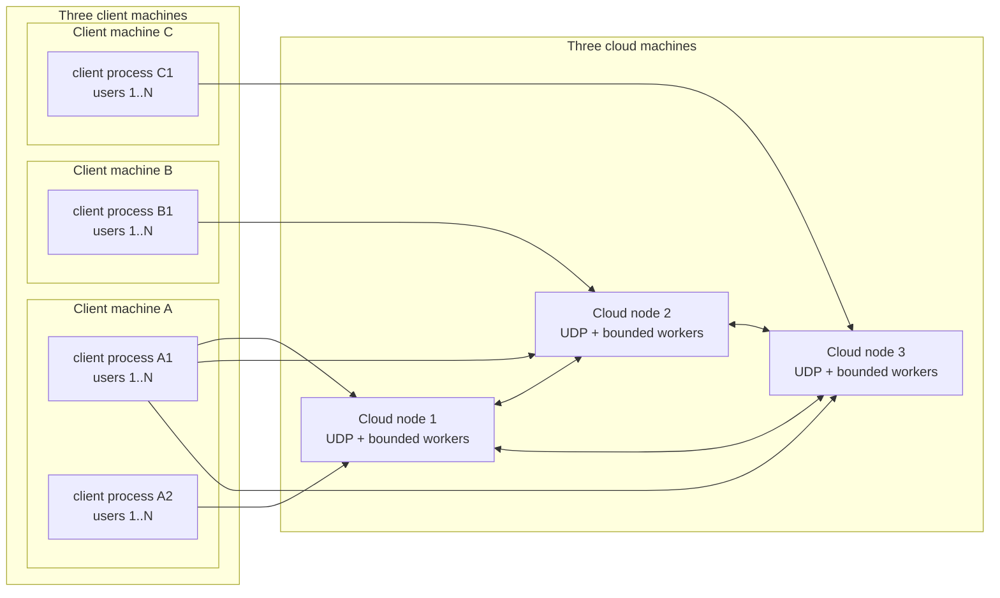

# Phase 1: Concurrent Request Processing

## A. System Process Model

RescueMesh currently runs one cloud-node process per cloud machine. Three client
machines can each run multiple independent `client` processes; each process
simulates multiple users. A user sends one request at a time, while different
users and different client processes can have requests in flight together.



Each cloud process binds its configured UDP address, emits heartbeats, and runs
the existing per-request load-aware Bully election. The UDP protocol and
message definitions are in `src/node.rs`; election scoring and timing are in
`src/election.rs`. `src/fault_tolerance.rs` contains a separate recovery and
replicated-log manager, but it is not connected to the active `Node` request
path.

## B. Client-Side Parallelization Model

`src/client.rs` implements the `client` command. Simulated-user IDs are sent
through a bounded Tokio channel to a reusable worker set capped at the smaller
of the user count and `RM_CLIENT_MAX_IN_FLIGHT`; this avoids spawning a task
per user when stressing with a large user count. Each user's job independently
creates its requests and submits its next request after the previous one
completes (and after an optional per-user rate delay). A Tokio semaphore caps
the total in-flight requests for that client process. Tasks waiting for a
permit contribute to the client queue-wait measurement; a slow request owns
only its own task and UDP socket, so other users continue.

Each request has its own UDP socket and a request ID of the form
`<client-id>-user-<user-number>-<sequence>`. The default client ID includes the
process ID and a timestamp, so concurrently launched client processes have
separate ID namespaces. The client sends the same ID and reply socket to all
configured nodes, accepts only a `Reply` with that ID, and sends an `Ack` to
the replying node. A response therefore cannot be consumed by another
request's receiver. When overriding `RM_CLIENT_ID`, use a distinct value for
each process.

Both the simulated-user queue and request concurrency are bounded. Multiple
client-script instances on a physical machine are operationally started as
separate OS processes.

## C. Cloud-Node Parallelization Model

The node's UDP receive task forwards decoded messages over a bounded inbound
Tokio channel. Its dispatcher routes requests into a separate bounded request
queue; protocol messages continue to be handled independently of slow incident
work. If the request queue is full, that node returns a `Busy` response rather
than creating more work. The queue worker obtains a request semaphore permit
before spawning the request task, so task creation is bounded by active cloud
capacity and queued requests.

The processing semaphore limits full request lifecycles (election, processing,
replication, reply) to `RM_NODE_MAX_IN_FLIGHT`. The current planner is small,
but CPU plan construction is dispatched with `tokio::task::spawn_blocking` and
guarded by a separate `RM_CPU_WORKERS` semaphore. Its existing 300 ms
simulated service delay remains asynchronous and does not occupy a blocking
thread. A `JoinSet` supervises request tasks; a failed task is logged, its
idempotency reservation is released, and registered clients receive `Busy`.

The ingress and request queues are bounded by `RM_REQUEST_QUEUE_CAPACITY`.
When the inbound queue fills, the UDP receive task waits to forward messages,
providing bounded in-process backpressure (UDP senders can still lose packets
if operating-system buffers overflow). If `request_tx` is full, the node sends
`Busy` for the request (and duplicate waiters on that ID); clients wait for
another node's response, but return an error if every configured node responds
`Busy`. Requests already admitted continue processing. The request dispatcher
can also hold one dequeued item while waiting for an active-request permit, in
addition to the configured request-channel capacity.

## D. Request Lifecycle

```mermaid
sequenceDiagram
  participant U as Simulated user
  participant C as Client process
  participant N1 as Node 1
  participant N2 as Node 2
  participant N3 as Node 3
  U->>C: Create incident
  C->>C: Assign unique request_id and reply socket
  par Multicast request
    C->>N1: Request(id)
    C->>N2: Request(id)
    C->>N3: Request(id)
  end
  par Independent node work
    N1->>N1: Bounded queue; start per-request Bully election
    N2->>N2: Bounded queue; start per-request Bully election
    N3->>N3: Bounded queue; start per-request Bully election
  end
  N1-->>N2: Election / OK / Coordinator messages (request and attempt scoped)
  N1-->>N3: Election / OK / Coordinator messages (request and attempt scoped)
  Note over N1,N3: The existing load-aware Bully strategy selects a responsible node for this request.
  N2->>N2: spawn_blocking plan computation, if N2 wins
  N2->>N1: Replicate(plan, request_id)
  N2->>N3: Replicate(plan, request_id)
  N1-->>N2: ReplicateAck(request_id)
  N3-->>N2: ReplicateAck(request_id)
  N2-->>C: Reply(plan, under_replicated)
  C->>N2: Ack(request_id)
  C-->>U: Correlated result
  Note over U,N3: Other request IDs continue through their own tasks and election rounds concurrently.
```

The diagram shows node 2 as an example winner, not a fixed leader. Every
request is multicast to all configured nodes and elects independently; a
winner computes the response plan and sends it to peers. In the current node
path, peers acknowledge receipt of a plan and the winner returns a result with
`under_replicated=true` if the replication timeout ends without a majority.
This is the existing UDP/Bully protocol, not a Raft log-commit implementation.

## E. Synchronization and Safety

- Node plan, in-flight request/waiter, replication-ack, liveness, and client-ack
  maps are protected by short-lived standard mutexes. Locks are released before
  network sends, sleeps, elections, CPU work, and replication waits.
- The election strategy keeps per-request/per-attempt rounds in its own mutex
  map and notifies waiters through Tokio `Notify`. Replication acknowledgments
  are grouped by request ID.
- A node keeps a per-node `started` set and cached plans. Duplicate IDs received
  while queued or processing join the existing request's reply-waiter list;
  retries after completion receive the cached plan. Queue-full requests release
  their in-flight reservation and receive `Busy`.
- The request ID is preserved in election, replication, reply, and ack
  messages. The client uses a separate socket per request and checks the ID
  before returning a response.
- Node admission and CPU work are separately bounded. Client admission is
  bounded by its in-flight semaphore. Client timeout and server election,
  execution-wait, and replication timeouts isolate stalled operations.
- The client command does not automatically retry timed-out requests. A caller
  that retries should reuse the same request ID to use node-level idempotency.
- Idempotency in the active UDP node is local to each node. A Bully split
  decision can still result in different nodes processing the same request;
  the current design does not claim distributed exactly-once execution.
- The `FaultToleranceManager` has independent async-RwLock state, idempotency,
  quorum-log, and recovery tests. It is not wired into the live UDP protocol,
  and its safety guarantees must not be attributed to this node path.

## F. Design Decisions and Trade-offs

- **Bounded async work instead of serial processing:** independent requests can
  progress while a request waits for election, processing, or replication.
  Tokio tasks are only started after acquiring a node permit.
- **Bounded queues instead of unbounded spawning:** request bursts are buffered
  only up to the configured capacity. Beyond that, a node can explicitly
  reject work with `Busy`; the UDP transport itself cannot guarantee delivery
  under operating-system buffer exhaustion.
- **`spawn_blocking` for the CPU step:** the current priority/plan computation
  is small, but the boundary keeps future CPU-heavy planner code from blocking
  Tokio workers. `RM_CPU_WORKERS` prevents overloading Tokio's shared blocking
  pool.
- **Independent request sockets instead of a shared response dispatcher:**
  this avoids a global response-routing lock and makes one slow response
  independent from other users. The trade-off is one ephemeral UDP socket per
  in-flight client request.
- **Existing election/replication retained:** Bully state and ack state are
  already keyed by request ID; no Raft or new load-balancing algorithm was
  introduced. This preserves current experiment semantics, but it means every
  request starts elections on multiple nodes and can amplify control traffic.
  A future leader-based Raft design should replace this request election /
  replication boundary rather than layering another coordinator into it.

## G. Testing and Performance

Run the automated tests with:

```powershell
cargo test
```

Tests cover the existing fault-tolerance suite, four concurrent client users
with request correlation and a delayed response, and an actual loopback node
that overlaps two of three requests, enforces the configured limit, and does
not execute a duplicate in-flight ID twice. A three-node UDP integration test
also submits two independent IDs simultaneously and verifies each response and
replicated plan remains associated with the correct request.

Build once from the repository root:

```powershell
cargo build --release
```

Then run these commands in three separate PowerShell terminals locally:

```powershell
$env:RM_NODES = "1@127.0.0.1:7001,2@127.0.0.1:7002,3@127.0.0.1:7003"
$env:RM_NODE_ID = "1"
.\target\release\rescue_mesh.exe node
```

```powershell
$env:RM_NODES = "1@127.0.0.1:7001,2@127.0.0.1:7002,3@127.0.0.1:7003"
$env:RM_NODE_ID = "2"
.\target\release\rescue_mesh.exe node
```

```powershell
$env:RM_NODES = "1@127.0.0.1:7001,2@127.0.0.1:7002,3@127.0.0.1:7003"
$env:RM_NODE_ID = "3"
.\target\release\rescue_mesh.exe node
```

On separate cloud machines, replace the loopback IPs with the three machines'
reachable IPv4 addresses (or IPv6 socket addresses) in the shared `RM_NODES`
value. For example:

```powershell
$env:RM_NODES = "1@10.0.0.11:7001,2@10.0.0.12:7002,3@10.0.0.13:7003"
$env:RM_NODE_ID = "1" # set to 2 on 10.0.0.12 and 3 on 10.0.0.13
.\target\release\rescue_mesh.exe node
```

Both `RM_NODES` and each node's own address must be reachable/bindable on the
machine; configure firewalls to permit UDP traffic on the three node ports.

Two independent client instances can run in separate PowerShell terminals on
the same machine. Each binds a distinct ephemeral UDP source port per request:

```powershell
$env:RM_NODES = "1@127.0.0.1:7001,2@127.0.0.1:7002,3@127.0.0.1:7003"
$env:RM_CLIENT_ID = "client-a"
$env:RM_CLIENT_USERS = "20"
$env:RM_CLIENT_REQUESTS_PER_USER = "20"
$env:RM_CLIENT_MAX_IN_FLIGHT = "16"
$env:RM_CLIENT_TIMEOUT_MS = "5000"
$env:RM_CLIENT_RATE_MS = "0"
.\target\release\rescue_mesh.exe client
```

```powershell
$env:RM_NODES = "1@127.0.0.1:7001,2@127.0.0.1:7002,3@127.0.0.1:7003"
$env:RM_CLIENT_ID = "client-b"
$env:RM_CLIENT_USERS = "20"
$env:RM_CLIENT_REQUESTS_PER_USER = "20"
$env:RM_CLIENT_MAX_IN_FLIGHT = "16"
$env:RM_CLIENT_TIMEOUT_MS = "5000"
$env:RM_CLIENT_RATE_MS = "0"
.\target\release\rescue_mesh.exe client
```

For 100 simulated users per client process, set `RM_CLIENT_USERS = "100"` in
each terminal; for example, set `RM_CLIENT_MAX_IN_FLIGHT = "64"` as well.
Each process independently reads its own settings. Increase
`RM_CLIENT_MAX_IN_FLIGHT` to permit more simultaneous client requests, and
raise `RM_NODE_MAX_IN_FLIGHT` and `RM_CPU_WORKERS` on the cloud nodes to
increase their admission and blocking-planner limits. Increase
`RM_REQUEST_QUEUE_CAPACITY` to buffer a larger burst; queue capacity does not
raise the processing limit. Keep machine resources in mind.

Configuration:

| Variable | Applies to | Default | Meaning |
|---|---|---:|---|
| `RM_NODES` | Node and client | Three loopback UDP addresses | Node ID/address list |
| `RM_NODE_ID` | Node | `1` | This cloud process's ID |
| `RM_NODE_MAX_IN_FLIGHT` | Node | `32` | Active request lifecycle limit |
| `RM_CPU_WORKERS` | Node | `4` | Concurrent blocking planner work |
| `RM_REQUEST_QUEUE_CAPACITY` | Node | `128` | Bounded ingress and request queue size |
| `RM_CLIENT_ID` | Client | Process ID + timestamp | Client-instance ID prefix |
| `RM_CLIENT_USERS` | Client | `10` | Simulated user tasks |
| `RM_CLIENT_REQUESTS_PER_USER` | Client | `10` | Requests per simulated user |
| `RM_CLIENT_MAX_IN_FLIGHT` | Client | `32` | Concurrent request limit |
| `RM_CLIENT_TIMEOUT_MS` | Client | `5000` | Per-request timeout |
| `RM_CLIENT_RATE_MS` | Client | `0` | Delay between requests per user |
| `RM_EXEC_TIMEOUT_MS` | Node | `3000` | Wait for elected winner's result |
| `RM_REPL_TIMEOUT_MS` | Node | `1500` | Replication retry deadline |

The client prints submitted, succeeded, failed, and timed-out totals; mean,
median, p95 and p99 client request latency; successful requests per second;
mean client semaphore wait; maximum observed in-flight requests; and response
counts by `processed_by_node`. Winning nodes print
`REQUEST,<request_id>,<node_id>,<queue_wait_us>,<processing_us>,<replication_us>`
records. The processing phase includes the current 300 ms simulated service
delay and plan computation. The replication phase measures the existing
request-specific replication wait. These measurements use client elapsed
time/local monotonic timers; there are no cross-machine latency comparisons.

No separate throughput benchmark has been run or is claimed here. The commands
above are reproducible load-run commands; record output from the actual
environment to compare throughput and latency as users and concurrency rise.
Known measurement limitations: queue wait covers time in the node's request
queue, not UDP kernel buffering; p95/p99 and client summaries are retained in
the client process until that finite workload finishes; replication failure is
reported with the existing `under_replicated` reply flag, which the current
client summary does not aggregate.
